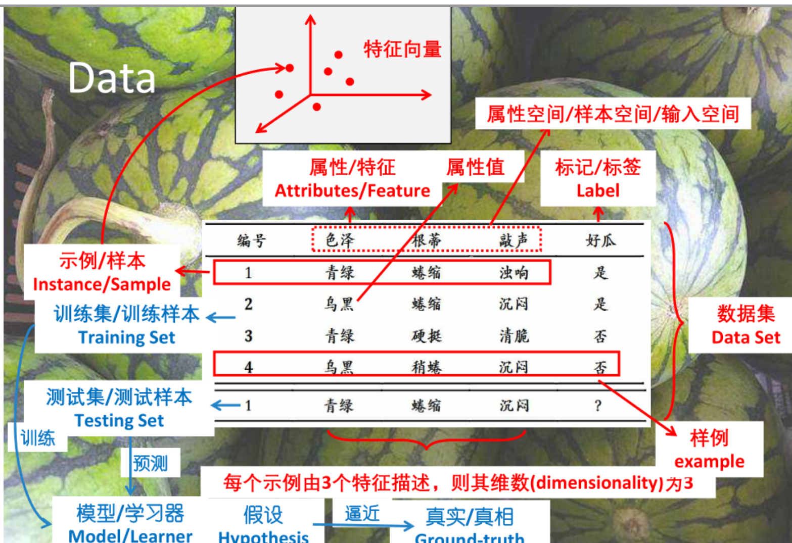

# Machine learning 笔记 1、2

# Lecture 1 definition

机器学习是研究如何从数据中自动学习潜在模式，并利用所学习的模式对未来样本进行预测或支持不确定环境下决策的一类方法。

机器学习的发展本质是“数据、模型和算力的协同扩展”，下一次范式突破很可能来自多模态与世界建模能力，而避免AI周期性波动的关键在于从规模驱动转向结构化与价值驱动。

首先，应当对模型能力进行**理性界定**。当前生成式模型在模式拟合和内容生成方面表现突出，但在因果推理、长期一致性和可靠性方面仍存在明显局限。因此，在对外表达和应用落地中，需要避免将其泛化为“通用智能”，而是明确其适用边界。

其次，需要构建**科学、可验证的评估体系**。如果仅依赖主观体验或展示性案例，容易高估模型能力。通过标准化 benchmark、真实业务指标以及鲁棒性测试，可以更客观地衡量模型性能，从而抑制不切实际的预期。

第三，应强调**从规模扩展转向结构优化**。单纯依赖更大模型和更多数据的 scaling 已经出现边际收益递减。未来更关键的是引入结构性约束，例如结合知识库、符号推理或因果建模，从而提升模型的稳定性和可解释性。

最后，在应用层面，应聚焦**高价值、可落地的具体场景**，而不是追求“全面替代人类”的宏大叙事。通过在垂直领域中逐步验证技术价值，可以形成正向反馈，避免预期泡沫的累积。

综上，避免这一循环的关键在于：**理性认知能力边界、建立客观评估体系、推进结构性创新，并坚持问题导向的应用落地**。这样才能使技术发展保持在可持续、稳健的轨道上。

模型不能被无限堆叠变大。虽然在一定范围内，增加模型规模可以提升性能，但这种提升存在明显的边际收益递减，并受到算力、数据和优化等多方面限制。随着模型规模不断增大，训练成本急剧上升，而高质量数据有限，可能导致过拟合或性能提升有限。因此，当前研究趋势不再是单纯扩大模型规模，而是通过结构优化、数据质量提升和模型效率改进来提升性能。

## Python和线性代数在机器学习中的作用

数据预处理：利用pandas清洗数据，处理缺失值，利用matplotlib绘制图进行数据可视化；对矩阵进行线性变化

特征工程阶段：

降维：实际上是对数据的协方差矩阵进行特征值分解，选取最大的几个特征值对应的特征向量，实现高维数据向低维的压缩。

在卷积神经网络中，卷积核在图像矩阵上滑动做点积，本质上是局部区域的矩阵运算。

模型评价：利用matplotlib绘制学习曲线，混淆矩阵，分析模型的过拟合/欠拟合情况

相关概念解析：

Artificial intelligence：

Final goal of machine intelligence

Pattern recognition:

通过算法自动发现数据中的规律和模式，并对数据进行分类和回归。

例子：手写数字识别，人脸识别，语音识别，早期模式识别系统基于人工规则和统计方法

Machine learning:

New term from 90s，data\-driven，learn a  model to predict\-关注点：算法的设计和优化。它关注如何从数据中学习一个模型，并用这个模型进行预测或决策。

例子：通过学习用户标记的垃圾邮件和正常邮件，自动识别新邮件是否为垃圾邮件。根据历史价格和交易量数据，预测未来趋势。

Data mining:

从大量数据中挖出有价值的知识/规律。包括数据清洗/集成/选择/变化/挖掘/模式评估和知识表示。

例子：啤酒与尿布——通过分析超市购物篮数据，发现啤酒和尿布的销量在特定时间段有强关联。

Deep learning:

The new wave of machine learning techniques based on convolutional nural networks\.

机器学习的一个子集。使用包含多个隐藏层的人工神经网络，端到端的学习方式和自动特征提取

例子：imagnet 深度学习模型大幅提升图像识别准确率

Generative AI:

The paradigm shift from analyzing data to creating new content\.

Large language models:

一种基于海量文本数据训练而成的、参数规模巨大的深度学习模型（通常是变换器架构），能够理解和生成自然语言，并执行多种复杂的语言任务。

Foundation models trained on massive datasets with billions of parameters,demonstrating reasoning abilities\.

### Framework

步骤1: 定义一个函数集合 \(Function Set\)  →  Model

我们事先假设目标函数属于某个特定的函数族（Function Family），这个函数族中的所有可能的函数构成了搜索空间。like：

- 线性模型：函数集合 = `{ f(x) = w·x + b | w ∈ R^d, b ∈ R }`（所有可能的直线/超平面）

- 决策树：函数集合 = 所有可能的树形结构

- 神经网络：函数集合 = 所有可能的网络结构和权重组合（极其庞大）

步骤2: 定义函数的好坏 \(Goodness of Function\) →  Loss Function

\-需要一个度量标准（损失函数和整体目标函数）来评价候选函数 `f` 的好坏

步骤3: 挑选出最好的函数 \(Pick the Best\) →  Optimization Algorithm

## 机器学习历史

专家系统\-

统计方法\-

深度学习\-

大语言模型\-

复杂模型不一定更好，因为模型性能取决于复杂度与数据规模的匹配关系。过于复杂的模型容易在训练数据上过拟合，将噪声当作规律，从而导致泛化能力下降。同时，复杂模型通常需要更多数据和计算资源支持，在数据不足或质量不高时，其优势无法体现。此外，随着模型复杂度增加，性能提升会出现边际收益递减。因此，更优的模型应是在偏差与方差之间取得平衡，而不是一味追求更高复杂度。

因此，应根据数据规模和任务需求选择合适复杂度的模型。

instance/sample\-只有feature 没有label

Example= feature\+label

对于符号操作和逻辑推理，决策树\-通过树形结构对数据进行分类，处理非结构化数据（图像/语音）能力较弱，且难以处理不稳定性和噪声

智能源于神经元之间的连接，通过模拟人脑神经网络的结构，用大量的计算单元和它们之间的连接权重来学习和表示知识。

早期（感知机）最早的神经网络模型

中期（反向传播）\-反向传播算法的普及让多层神经网络变得可训练

现代（深度学习）卷积神经网络CNN，循环神经网络RNN，Transformer

MLP\-多层感知机 transformer（当前大语言模型的核心架构）

代表方法：

支持向量机SVM，逻辑回归logistic regression，朴素贝叶斯，隐马尔可夫模型HMM

机器学习框架framework：

步骤1: 定义一个函数集合 \(Function Set\)  →  Model

步骤2: 定义函数的好坏 \(Goodness of Function\) →  Loss Function

步骤3: 挑选出最好的函数 \(Pick the Best\) →  Optimization Algorithm

## 机器学习任务分类体系

机器学习任务

│

├── 按预测目标分类 prediction target

│   ├── Classification（分类）—— 输出离散标签

│   │   ├── Binary（二分类）：好瓜/坏瓜

│   │   └── Multiclass（多分类）：黄瓜/南瓜/西瓜

│   │

│   ├── Regression（回归）—— 输出连续数值

│   │   └── 西瓜成熟度、房价、温度

│   │

│   └── Clustering（聚类）—— 输出无标签的簇

│       └── 无标签的瓜果自动分组

│

└── 按标签可用性分类 label

├── Supervised Learning（监督学习）

│   └── 输入：X \+ Y（有标签）

│   └── 任务：Classification \+ Regression

│

├── Unsupervised Learning（无监督学习）

│   └── 输入：X only（无标签）

│   └── 任务：Clustering, 降维, 关联规则

│

└── Semi\-supervised Learning（半监督学习）

└── 输入：少量 \(X,Y\) \+ 大量 \(X only\)

└── 任务：利用无标签数据辅助学习

### PCA VS LDA:

PCA\- 主成分分析 无监督学习 LDA\-线性判别分析\-监督学习降维 使得类间距离/类内距离最大

### 无监督学习：聚类，异常检测，降维，表示学习

1️⃣ 聚类（Clustering）

**任务**：把数据自动分组 

**例子**： 

用户分群（高消费 / 低消费） 

新闻聚类（自动分主题） 

算法：

K\-Means  DBSCAN Hierarchical Clustering（层次聚类）Gaussian Mixture Model（GMM）

2️⃣ 降维（Dimensionality Reduction）

**任务**：把高维数据压缩到低维 

**例子**： 

图像特征可视化 

文本 embedding 降维 

👉 算法：

PCA主成分分析\-保留方差最大也就是保留数据变化最明显的方向  

t\-SNE UMAP

异常检测：

Isolation Forest One\-Class SVM

密度估计：学习数据出现的概率分布

Kernel Density Estimation（KDE）

Gaussian Mixture Model（GMM）

表示学习（representation learning）：自动学习好的数据表示，

半监督学习：

二、半监督学习（Semi\-supervised Learning）

✅ 核心定义

> **少量有标签 \+ 大量无标签数据共同训练**
> 
> 

🎯 典型例子

1️⃣ 图像分类（最经典）

有 100 张有标签图片 

10,000 张无标签图片 

👉 做法：

用有标签训练初始模型 

给无标签打“伪标签（pseudo\-label）” 

再一起训练 

2️⃣ 文本分类

少量标注评论（正/负） 

大量未标注评论 

👉 应用：

情感分析 

- 垃圾邮件分类

# Lecture 2 model selection

Overfitting can only be alleviated 

## 数据集划分（以生成训练集和测试集）的常见方法 \(Data Splitting Methods\)

这三种方法都是模型评估与选择中用于划分数据集的方法。它们的核心目的是：在有限的数据集上，尽可能可靠地评估模型的泛化能力。

### 1\.Hold out 留出法

方法：将数据集切分成两个互斥集合

**优点：**

- **计算开销最小：** 只需训练一次模型。

- **逻辑简单：** 容易实现，适合快速迭代和大规模数据集。

**缺点：**

- **结果不稳定性：** 评估结果高度依赖于划分的具体方式（例如刚好把难分类的样本都分到了测试集）。

- **数据利用率低：** 训练集和测试集的规模存在矛盾。训练集大则模型更接近原始分布，但测试集变小导致评估不准；反之亦然。

**适用场景 \(Situation\)：**

- **大数据量：** 当你有百万级以上的数据时，留出法非常稳健（例如 $80\%/10\%/10\%$ 划分训练/验证/测试集）。数据足够多时，一次划分已经能代表整体分布

- **算力受限：** 模型训练极其耗时（如大型深度学习模型），无法承担多次训练。深度学习/大模型微调。不适合反复训练

- **快速原型验证**：baseline阶段，需要快速判断模型是否可用

When dividing the data set, try to ensure the consistency of data distribution as much as possible\! 

分层采样：保留类别比例 

### 2\.Cross validation 交叉验证法

通过多次划分并取多次的平均值来抵消偶然性

**优点：**

- **评估最准确：** 几乎所有样本都参与了训练和测试，减少了因数据划分不同而引入的偏差。

- **稳定性高：** 通过多次实验取平均，能更真实地反映模型的泛化能力。

### 适用场景：

1\.数据量中等（千级\-万级）

2\.模型选择/超参数调优

3\.学术研究/benchmark

**缺点：**

- **计算代价大**

5次10折交叉验证一共需要训练多少次？ 5\*10\+1

### 3\.booststrapping 自助法

基于自助采样（可重复抽样）。

- **做法：** 从包含 $m$ 个样本的数据集中有放回地随机抽取 $m$次。

- **结果：** 约有 $36.8%$的数据始终不会被抽到。这些没被抽到的数据就作为测试集。

- **适用场景：** 数据集较小、难以有效划分训练/测试集时。

#### 主要优势 \(Advantages\)

- **缓解小样本规模下的过拟合风险 \(Small Sample Robustness\)：**

- 在数据集规模 $\mathcal{D}$ 极小时，留出法或交叉验证会进一步缩减训练集规模，导致模型无法有效捕捉底层分布。自助法通过**有放回采样 \(Sampling with Replacement\)**，确保训练集规模与原始数据集一致，从而最大化利用已知样本信息。

- **支持包外估计 \(Out\-of\-Bag Estimation, OOB\)：**

- 由于约有 $36.8\%$ 的样本未参与模型训练，这部分**包外数据**可作为天然的独立验证集。这种机制允许在不额外划分测试集的情况下，对泛化误差进行无偏估计。

- **集成学习的基石 \(Foundational for Ensemble Learning\)：**

- 自助法是 **Bagging \(Bootstrap Aggregating\)** 算法的核心。通过产生多个具有差异性的子数据集，可以训练出多样化的基学习器（Base Learners），有效降低整体模型的**方差 \(Variance\)**，代表性应用为随机森林。

#### 局限性与缺失 \(Limitations\)

- **引入估计偏差 \(Estimation Bias\)：**

- 自助抽样产生的训练集包含了大量重复样本，这改变了原始数据集的概率分布特性。这种分布偏差（Distribution Shift）会导致评估结果产生系统性偏倚，在数据量充足时，其准确度通常逊于 $k$ 折交叉验证。

- **计算复杂度随集成规模线性增长：**

- 虽然单次训练成本与留出法相当，但在集成学习场景下，为了追求预测稳定性，通常需要进行数百次自助抽样并训练对应模型，这会显著增加计算资源的消耗。

### 适用场景：

数据量极小（\<1000,甚至\<100\),无法有效划分train/set

需要估计模型性能分布，方差/置信区间

不稳定模型分析：决策树/弱学习器

## 性能度量 \(Evaluation Criteria\)

有了测试结果后，我们需要量化的标准来衡量“好坏”：

## 平衡点 \(Break\-even Point, BEP\)

当两个分类器的 P\-R 曲线发生**交叉**时（如下图所示），很难一眼看出谁更好。

- **定义：** 曲线上的 $Precision = Recall$的那个点。

- **逻辑：**BEP 是衡量交叉曲线性能的一种简单指标。**BEP 值越高，通常代表模型性能越好。**

- **局限：** BEP 还是太简略了。

ROC 曲线衡量的是：模型区分正负样本的“排序能力”\-随机抽一个正样本和一个负样本，模型把正样本排在前面的概率

PR 曲线衡量的是：你找出来的“正类”中，有多少是真的

绘制ROC曲线：

- 光滑的ROC曲线：理论上，当测试样本无限多，且模型对正负类输出的概率分布是连续、平滑时，TPR和FPR随阈值连续变化的效果。它更像一个概念模型。

- 近似的ROC曲线：在现实中，我们只有有限个（m个正样本，n个负样本）测试样本。模型对每个样本只能输出一个预测值。当我们改变阈值时，TPR和FPR只会在遇到一个样本的预测值时 发生跳跃式 的变化，而不是连续变化。因此，画出来的是阶梯状的折线。

绘制步骤：

### 分步图解：如何用有限样本绘制ROC曲线

你提供的绘制步骤非常标准。我们假设有 m个正样本 和 n个负样本。核心思想是：将分类阈值依次设置为每个样本的模型预测值。

1. 样本排序：
首先，将所有测试样本（m\+n个）按照模型预测的 正例概率得分 从高到低排序。

2. 初始化：
将分类阈值设为 最高分\+ε，此时没有任何样本被预测为正例。

    - 真正例率 TPR = 0 / m = 0

    - 假正例率 FPR = 0 / n = 0

    - 所以，第一个标记点为 `(0, 0)`。

3. 移动阈值并绘制阶梯：
现在，将阈值 从高到低 依次设置为每个样本的预测得分。每次移动阈值，都会“新纳入”一个样本将其预测为正例。

    - 从上一个标记点 `(x, y)` 开始。

    - 情况一：当前新纳入的样本是 正样本

        - 这意味着正确找出了一个正例。TPR 会上升。

        - TPR 的上升幅度是 `1/m`。

        - 所以新点的坐标变为：`(x, y + 1/m)`。这是一个 垂直向上 的移动。

    - 情况二：当前新纳入的样本是 负样本

        - 这意味着错误地把一个负例当成了正例。FPR 会上升。

        - FPR 的上升幅度是 `1/n`。

        - 所以新点的坐标变为：`(x + 1/n, y)`。这是一个 水平向右 的移动。

4. 连接相邻点：
当处理完所有 `m+n` 个样本后，我们就得到了 `m+n+1` 个点（包括起点）。将这些点按顺序连接起来，就形成了一条从 `(0,0)` 出发，最终到达 `(1,1)` 的 阶梯状折线。每一步要么向上（遇到正样本），要么向右（遇到负样本）。

AUC就是模型在所有阈值下的平均真正例率，也就是在所有可能的分类决策门槛下的平均表现。

*AUC*=*P*\(正样本的预测分\>负样本的预测分\)

### ROC 与 P\-R 的核心区别：数据分布敏感性 

### ROC 曲线的“稳重” \(Invariance\)

- **特点：** 当测试集中**正负样本比例发生剧烈变化**时，ROC 曲线的形状基本保持不变。

- **原因：** TPR 只关注正样本内部（$TP+FN$），FPR 只关注负样本内部（$TN+FP$）。它们各自在自己的类别里“闭门造车”，互不干扰。

- **适用：** 评估模型本身的算法性能，不受数据比例偏置的影响。

### P\-R 曲线的“敏感” \(Sensitivity\)

- **特点：** 当负样本突然变多时（**类别不平衡**），P\-R 曲线会发生剧烈变动（通常会大幅下降）。

- **原因：** Precision 的分母包含了 $FP$（误诊）。如果负样本极多，即使误诊率很低，$FP$的绝对数值也会变得很大，导致 Precision 骤降。

- **适用：** 极度不平衡的数据集（如：反欺诈、反洗钱，1万笔交易只有1笔违规）。在这些场景下，P\-R 曲线比 ROC 更有参考价值，因为它能直观反映出“抓出来的到底准不准”。

## 直观理解

### 偏差（Bias）

- 定义：模型预测的平均值与真实值之间的差距。反映模型拟合能力的不足。

- 随阶数变化：模型阶数越高，模型越灵活，越能逼近复杂的真实函数，因此偏差单调下降。

    - 低阶模型（如线性）：假设太强，无法拟合非线性关系 → 高偏差（欠拟合）

    - 高阶模型（如高次多项式、深层网络）：理论上可以拟合任意函数 → 低偏差

### 方差（Variance）

- 定义：模型在不同训练集上预测结果的波动程度。反映模型对训练数据噪声的敏感度。

- 随阶数变化：模型阶数越高，模型越容易“记住”训练数据中的随机噪声，因此方差单调上升。

    - 低阶模型：决策边界平滑，对数据扰动不敏感 → 低方差

    - 高阶模型：决策边界剧烈振荡，稍微改变一个训练点，模型就会大变 → 高方差（过拟合）

简单模型更不容易受到数据的扰动影响

错误率曲线

欠拟合——换更加复杂的模型/加特征

过拟合——加数据/正则项（相当于对于复杂性的惩罚项）

# 

