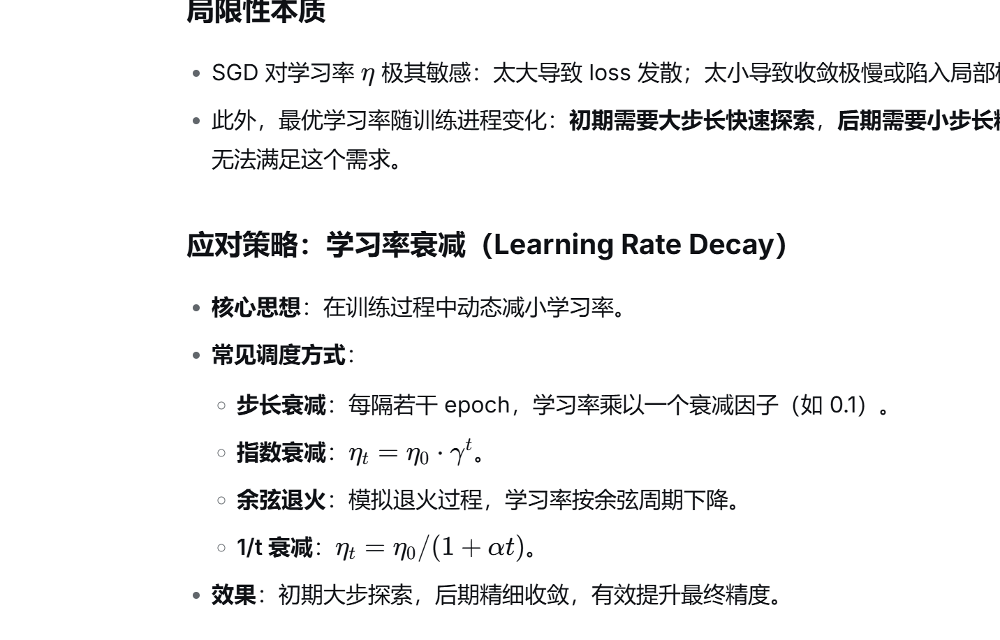
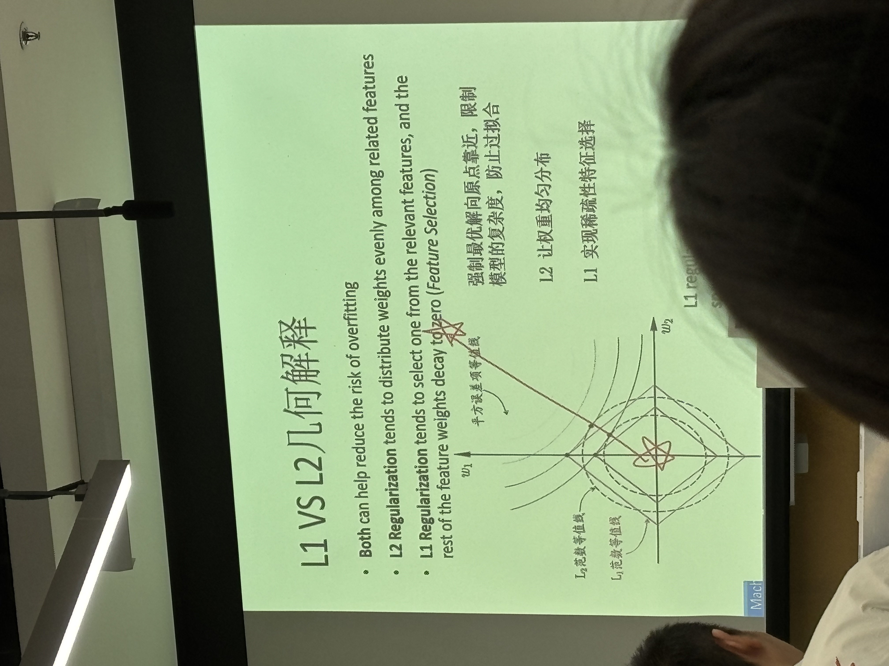

# Machine learning 笔记 3

# Lecture 3 

## MAE\&MSE

MAE\- mean absolute error

MSE\- mean square error

Cross\-entropy 交叉熵：

当 y和 y^都是概率分布时（例如分类问题中Softmax的输出），交叉熵衡量这两个分布之间的差异。其公式为：

- 含义：它表示用估计分布 y^来表示真实分布 y所需的平均信息量（比特数）。交叉熵越小，说明两个分布越接近。

- 应用场景：几乎专用于分类问题（二分类、多分类）。它配合Softmax输出和梯度下降，能获得非常好的优化特性（梯度与误差成正比，避免饱和慢速问题）。

#### 使用 MSE 的典型场景：

- 输出连续，且误差服从高斯分布（MSE等价于极大似然估计下的高斯噪声）。

- 对小误差更敏感，希望模型尽量逼近精确值。

- 没有明显异常值outliers离群点，（否则模型会被带偏）。

- 需要光滑、可导的损失函数（几乎所有深度学习框架默认对回归用MSE变体，但实际分类更常用交叉熵）。

#### 使用 MAE 的典型场景：

- 数据中存在很多噪声或异常值（MAE不会被少数巨大误差主导）。

- 对预测的鲁棒性要求高于精确性。

- 误差分布是拉普拉斯分布（尖峰厚尾）。

- 在需要稀疏解的某些模型中（L1正则化类似思路）。

#### 高斯分布\- \(Gaussian / Normal Distribution\)（又称为正态分布） mse squareo

其概率密度函数（PDF）包含误差的平方项：

$f(x | \mu, \sigma) = \frac{1}{\sigma \sqrt{2\pi}} \exp\left( -\frac{(x - \mu)^2}{2\sigma^2} \right)$

#### 拉普拉斯分布\(Laplace Distribution\) mae

$f(x | \mu, b) = \frac{1}{2b} \exp\left( -\frac{|x - \mu|}{b} \right)$

**尖峰（Sharp Peak）**：在均值 $\mu$ 处有一个明显的尖头（不可导点），这意味着数据在中心点极度集中。

**厚尾（Heavy Tails）**：虽然概率也会随距离下降，但下降速度远比高斯分布慢。这意味着它允许（或者说预期）数据中存在一定比例的较大偏差（异常值）。

#### 总结表：MSE vs MAE

> 额外建议：在深度学习的分类任务中，永远优先选交叉熵而不是MSE/MAE；回归任务中，若数据干净则MSE，若有离群点则考虑MAE或Huber损失（组合二者优点）。
> 
> 

#### 要找到最小损失应该怎么找？ 函数上升最快的方向是什么？ 

找到损失函数最小值的核心方法是**迭代优化**。

1. **初始化：** 随机给模型的权重 w 赋初值。

2. **计算梯度：** 计算损失函数 L 对权重 W 的导数 $\frac{\partial L}{\partial w}$。

3. **更新权重：** 沿着梯度的反方向（下降方向）移动一小步。

4. $w_{new} = w_{old} - \eta \cdot \nabla L$

5. 其中 $\eta$ 是**学习率**。

6. **循环：** 重复上述过程，直到损失函数不再下降或达到预设的停止条件。

在多维空间中，函数上升最快的方向是 **梯度 \(Gradient\)**

- 梯度是一个向量，其方向指向函数值增加速率最大的方向。

- 其大小（模长）等于该方向上的变化率（方向导数最大值）。

为什么要用负梯度下降？

- 因为我们要最小化损失函数，所以沿 负梯度方向（下降最快的方向）移动参数。

梯度是一个向量，由函数对每个维度的**偏导数 \(Partial Derivatives\)** 组成。

**符号：** $\nabla f(x, y, \dots) = \left[ \frac{\partial f}{\partial x}, \frac{\partial f}{\partial y}, \dots \right]$

**直观理解：** 梯度向量指向的是函数值**增加最快**的方向。

#### 任意方向的斜率（Directional Derivative）:

如果想知道函数在**某一个特定方向**（不仅仅是坐标轴方向）的斜率，该怎么办？

- **点积原理：** 任意方向 $\mathbf{v}$（单位向量）上的斜率等于该方向向量与梯度向量的**点积 \(Dot Product\)**。

- **公式：** $\text{Slope}_{\mathbf{v}} = \mathbf{v} \cdot \nabla f$

- **数学意义：** 当 $\mathbf{v}$ 与梯度方向一致时，点积最大（上升最快）。

    - 当 $\mathbf{v}$ 与梯度方向相反时，点积最小（下降最快）。

    - 当 $\mathbf{v}$ 与梯度垂直时，点积为 0（函数值在该方向瞬间不变）。

    ## 普通梯度下降方法与三种方法

    #### 梯度下降（gradient descent）：

    **最陡下降方向：** 正梯度是上升最快的方向，那么其反方向——**负梯度 \(**$-\nabla f$**\)** 就是**下降最快**的方向。

    The direction of steepest descent is the negative gradient\.

### 学习率：

学习率过大会导致损失震荡不收敛oscillate 震荡and fail to converge 不收敛/loss oscillation and non\-convergence

学习率过小会导致收敛速度太慢slow convergence

使用指数增长方式进行尝试修改学习率，

特征缩放 feature scaling sgd/ada 三种算法应该如何选择

### 特征缩放 \(Feature Scaling\)

将数据转换为均值为 0，方差为 1 的分布。

**公式：**

$z = \frac{x - \mu}{\sigma}$

其中 $\mu$ 为均值，$\sigma$ 为标准差。

- **步骤：** 减去均值（中心化）并除以标准差。

- **特点：** 处理后的数据符合标准正态分布，对异常值比归一化更具**鲁棒性**。

特征缩放通过将不同量纲（单位）的特征转换到相同的数值范围（如 0 到 1，或均值为 0 方差为 1），来优化损失函数的形状。

#### 必须进行缩放的场景：

1. **基于梯度的模型：** 线性回归、逻辑回归、神经网络、支持向量机 \(SVM\)。

2. **基于距离的模型****：** K\-近邻 \(KNN\)、K\-均值聚类 \(K\-Means\)。

3. **特征提取算法：** 主成分分析 \(PCA\)、线性判别分析 \(LDA\)（这些算法试图找到方差最大的方向，量纲大的特征会虚增方差）。 

#### 不需要（或可选）缩放的场景：

1. **树模型：** 随机森林 \(Random Forest\)、XGBoost、LightGBM、决策树。

    - **原理：** 树模型是通过选择特征的最优切分点来分叉的。切分点的选择仅取决于特征值的**相对次序（Rank）**，而不是绝对数值。

2. **朴素贝叶斯：** 通常不直接受特征量纲的影响。

#### 适用场景

- **几乎所有的神经网络：** 神经网络对输入极其敏感。

- **距离度量算法：** 如 KNN、SVM、K\-Means（否则数值大的特征会主导距离计算）。

- **基于梯度的优化：** 只要你用 SGD 或 Adam，特征缩放就是**强制性**的。

#### 详细分析

如果没有特征缩放，损失函数的等高线会呈现为“细长的椭圆”。

- **后果：** 梯度方向会垂直于等高线，导致在短轴方向剧烈震荡，长轴方向进展缓慢。

- **缩放后：** 损失表面变成一个圆形的“碗”。梯度直指中心，允许使用更大的学习率，收敛速度提升数倍。

### SGD \(随机梯度下降\)Stochastic Gradient Descent

SGD 及其变体（如 Momentum）是神经网络最经典的优化器。它在每一步更新时只使用一个样本或一小批样本（Mini\-batch）。

#### 适用场景

- **计算机视觉 \(CV\)：** 在 ResNet、VGG 等视觉模型中，带动量的 SGD 往往能获得比 Adam 更高的最终精度（泛化能力更强）。

- **大规模数据训练：** 当内存不足以支撑全量数据时，SGD 是唯一选择。

- **模型精调 \(Fine\-tuning\)：** 当你已经有一个很好的预训练模型，想在小步迭代中稳定收敛时。

#### 详细分析

- **优点：** 引入了随机性，有助于跳出局部最小值（Local Minima）；算法简单，计算开销极低。

- **缺点：** 学习率（Learning Rate）非常难调。如果设得不好，模型可能永远无法收敛。

#### 纯随机梯度下降 \(Pure SGD\)

在纯 SGD 模式下，算法在每一次迭代中仅随机抽取**一个**样本$(x^{(i)}, y^{(i)})$ 来估计全体梯度的方向。其参数更新公式为：

$\theta_{t+1} = \theta_t - \eta \cdot \nabla_{\theta} L(f(x^{(i)};\theta_t), y^{(i)})$

**数学含义：** 这里的随机梯度是全梯度的**无偏估计（Unbiased Estimate）**。由于单样本梯度的方差极大，更新路径会表现出剧烈的震荡，这种高度随机性使得模型难以精确稳定在极小值点。

#### 小批量随机梯度下降 \(Mini\-batch SGD\)

为了平衡计算效率与估值稳定性，实践中常用小批量方法。设小批量样本集合为 $\mathcal{B}$，其更新公式为：

$\theta_{t+1} = \theta_t - \eta \cdot \frac{1}{|\mathcal{B}|} \sum_{i \in \mathcal{B}} \nabla_{\theta} L(f(x^{(i)};\theta_t), y^{(i)})$

**数学含义：** 通过对 m 个样本求平均，梯度的方差被降低了 m 倍。这不仅能利用现代硬件（如 GPU）的并行计算能力，还能在保持随机性的同时，提供比单样本更稳定的下降方向。

#### 随机性的动力学特性：

##### 收敛速度的权衡

普通梯度下降（Batch GD）每一步更新都需要遍历所有 $N$ 个样本，计算复杂度为 $O(N)$。在超大规模数据集下，这种线性的代价是不可接受的。

- **频率优势：** SGD 可以在遍历一次数据集的时间内完成 $N/|\mathcal{B}|$ 次更新。即便每一步的方向不够精确，但高频率的迭代使得模型在早期能以极快的速度接近最优解区域。

##### 逃逸效应与正则化 \(Escaping Local Minima\)

随机梯度中的“噪声”并非纯粹的干扰，它具有深刻的动力学意义：

- **逃离鞍点与局部最优：** 在复杂的非凸损失表面，BGD 极易困在梯度为零的平坦区域或浅层局部最小值中。SGD 的波动性（Fluctuation）为参数提供了“动能”，使其能够跳出这些陷阱，寻找更深层的全局最优。

- **隐式正则化：** 这种随机性在某种程度上起到了一种正则化作用，防止模型过度拟合训练数据中的特定噪声，从而提升泛化能力。

#### 局限性与应对策略：

**高方差导致的不稳定性：**

- *应对方案：* 引入**动量 \(Momentum\)**。通过累积历史梯度方向来平滑震荡，加速在平坦区域的行进。

**学习率高度敏感：**

- *应对方案：* 使用**学习率衰减 \(Learning Rate Decay\)**。初期给予较大步长快速探索，后期逐步减小步长以实现精确收敛。

\*备注：深度学习模型的非凸性使得SGD“噪声逃离”特性变得非常重要

### Adaptive Algorithms \(Ada 系列/自适应算法\)

这类算法（如 Adagrad, RMSprop, Adam）会自动为每个参数调整学习率。

Adagrad\-

$w_{t+1} = w_t - \frac{\eta}{\sqrt{\sum_{i=0}^t (g_i)^2 + \epsilon}} \cdot g_t$

- $g_t$**：** 当前步的梯度。

- $\sum (g_i)^2$**：** 这是灵魂所在。它记录了**从第一步到现在所有梯度的平方和**。

- $\epsilon$**：** 一个极小值（如 $10^{-8}$），防止分母为 0。

1. **梯度大 **$\to$** 步伐小：** 如果某个参数在过去几步中梯度一直很大，分母就会变得很大，导致整体步长缩减。

2. **梯度小 **$\to$** 步伐大：** 如果某个参数几乎没有梯度（稀疏特征），分母就增长得很慢，学习率依然维持在一个较高的水平。

> **Adagrad 的致命弱点：**
> 
> 由于分母是梯度的**累积平方和**，它只会越来越大。这意味着学习率会**单调递减**。
> 
> 训练到后期，学习率会变得极小，导致模型还没走到终点就“走不动了”（提前停止学习）。
> 
> 为了解决 Adagrad 学习率消失太快的问题，后续算法进行了改进：
> 
> - **`Root Mean Square Propagation（均方根传播）RMSprop：`**` 它不再累积全部历史梯度，而是使用`**`指数移动平均（EMA）`**`，只关注最近一段时间的梯度，``而不是死记硬背所有历史。`根据每个参数历史梯度平方的大小，自适应调整每个参数的学习率。
> 
> - **Adam：** 它把 **RMSprop**（调整步长）和 **Momentum**（调整方向）结合在了一起。它是目前最流行的优化器，因为它既能像 Adagrad 一样为不同参数分配步长，又能像动量法一样通过累积历史梯度方向来平滑震荡（在梯度方向反复变化的区域），加速在梯度方向一致区域（平坦区域）的行进。p平滑震荡，加速收敛
> 
> 
> 
> ### **Adam\-**\-Adaptive Moment Estimation，自适应矩估计优化算法
> 
> Momentum \+ RMSProp 的结合体
> 
> 既利用动量稳定方向，又使用自适应学习率调整不同参数的更新幅度。
> 
> 
> 
> Momentum 的效果是：引入动量\-可以理解为历史梯度的加权平均
> 
> - 如果多个 batch 的梯度方向大致一致，那么动量会不断累积，使更新更快； 
> 
> - 如果某个方向的梯度来回震荡，正负抵消后会变小，震荡会被抑制。 
> 
> 所以 Momentum 主要解决：
> 
> **更新方向更稳定、更有惯性。**
> 
> 但它没有解决一个问题：
> 
> 每个参数的学习率仍然是一样的。
> 
> 一阶矩估计 动量
> 
> 二阶矩估计  类似调整每个参数的学习率
> 
> 
> 
> Adam的优势：在训练初期收敛速度很快，对学习率不那么敏感，对稀疏梯度比较友好，\(因为它可以给不同参数独立维护学习率\),对噪声梯度较鲁棒，实现简单效果稳定，
> 
> 缺陷：泛化能力有时不如SGD，比如在追求极致方法的泛化的部分cv任务，不适用于资源极度受限的大模型训练
> 
> ，训练后期实际步长偏大，参数更新不稳定
> 
> - **计算机视觉 \(CV\)：** 在 ResNet、VGG 等视觉模型中，带动量的 SGD 往往能获得比 Adam 更高的最终精度（泛化能力更强）。
> 
> - adam一阶矩估计：类似动量，指数移动平均m\_t
> 
> - adam\-二阶矩估计：类似ada，梯度平方大小，调整每个参数的学习率v\_t
> 
> 
> 
> 在某些任务中，Adam 的自适应更新更容易快速拟合训练集，并可能收敛到泛化较差的解；SGD 的 mini\-batch 噪声和较简单的更新方式，会带来一种隐式正则化，有时更偏向平坦、泛化更好的区域
> 
> 

#### 适用场景

- **自然语言处理 \(NLP\) 与 稀疏数据：** 单词出现的频率差异巨大。Ada 算法能给出现频率低的特征（稀疏特征）更大的更新步长。

- **复杂神经网络架构：** 如 GAN、增强学习或深层 Transformer，手动调学习率极难。

- **快速原型开发：** 当你不想花几天时间调学习率，只想快点看到结果时，**Adam 是默认首选**。

#### 为什么自适应学习率算法比普通梯度下降收敛更快？

动态调整每个参数的学习率，而不是使用全局固定的学习率

使用普通梯度下降方法会出现：单一全局学习率 *η*：对所有参数使用相同的步长。但是不同参数可能需要的补偿差异比较大，且不能自动适应稀疏特征

#### 算法细分比较

### 梯度下降会遇到局部最优鞍点等问题，在实际训练中是核心问题吗？

在高维参数空间中，局部最优（local minima）并非核心问题，鞍点（saddle points）和学习率调优（涉及到极平坦区域plateaus）才是实际训练中更需要关注的

原因：

要成为局部最小值，函数在所有 $n$ 个维度上都必须同时处于“凹向”（即海森矩阵$H$ 的所有特征值都为正）。在高维空间中，这种概率非常小，几乎为0，相比之下，鞍点的概率更高（一部分维度向上弯曲，另一部分维度向下弯曲）。

会带来梯度消失和收敛停滞的问题，模型难以捕捉到下降方向，在鞍点附近来回震荡

### 梯度下降存在隐含的前提假设：

#### 1\.1 训练数据具有充分性与代表性

梯度下降本质上是在**经验风险**（已有数据）上寻找最优。它假设训练集是真实世界的完美缩影。

- **逻辑：** 如果数据有偏（Bias），梯度下降学到的就是偏见；如果数据不足，梯度下降就会在噪点中“迷失”。

#### 1\.2 损失函数能准确定义“好模型”

它假设 $L(\theta)$ 的最小值点真的对应着任务的最优解。

- **逻辑：** 如果损失函数选错了（例如回归问题强行用分类损失），即使梯度降到了 0，模型在现实中也可能毫无用处。

#### 1\.3 模型复杂度（容量）适中

假设模型的参数空间足以容纳真实的映射关系，但又不会大到去“背诵”数据。

#### 1\.4 参数初始化在合理的搜索空间内

虽然高维空间鞍点多，但梯度下降仍假设初始点不会落入梯度彻底消失的“死区”（如所有权重设为 0 或极大值导致的饱和）。

#### 1\.5 优化过程是稳定且收敛的

它假设通过合适的步长（Learning Rate），我们能够平滑地接近驻点，而不是在损失平面上永无止境地跳跃。

深度学习训练中的实际问题对比表 \(Practical Issues\)

正则化核心思想：在损失函数中加入正则项，惩罚复杂模型，偏好简单模型。

- 防止过拟合：限制模型复杂度，使得模型不会过分依赖某些特征或学习训练数据中的噪声。

- 提升泛化能力：使模型在未见数据上表现更稳定。

- 从贝叶斯视角：相当于给权重 零均值高斯先验分布 \( wi∼N\(0,1/λ\)，从而引入“权重应该小且接近零”的先验知识。

标准的梯度下降更新公式为：

$w \leftarrow w - \eta \nabla_w L_0$

加入 L2 正则化后，更新公式变为了：

$w \leftarrow \underbrace{(1 - 2\eta\lambda)}_{\text{衰减因子}} w - \eta \nabla_w L_0$

- 由于 $2\eta\lambda$ 通常是一个很小的正数（例如 0\.001），所以 $(1 - 2\eta\lambda)$ 会略小于 1。

L1正则化：惩罚绝对值权重，自动筛选出对预测最重要的少数特征，剔除冗余或不相关的特征。

通过减少有效特征数量，降低模型复杂度。

产生稀疏解：最终模型中许多权重为零，模型更简单、可解释性更强。

适用场景：

1. 高维数据且特征数量远大于样本数（如基因数据、文本分类中词的 one\-hot 表示）。许多特征实际无用，L1 能自动筛选。

2. 需要模型可解释性的业务场景（如信贷评分、医疗诊断），希望知道哪些特征真正起作用。

3. 希望进行内嵌式特征选择，而不是先独立做特征选择再训练模型。

4. 数据中存在大量冗余特征，L1 比 L2 更有效地压缩模型。

L1与L2正则化方法对比表格：

L1 L2 正则化分别是做什么的

l1让w越小越好 实现稀疏性特征选择

l2让w接近为0，让权重均匀分布

L0计算w中为0的数量 L0求解为np\-hard 求解困难，因此不作为常规正则化手段

#### 为什么实际中几乎不用 L0 正则化？—— NP\-hard 问题

##### 组合爆炸

- 要找到最优的 L0 正则化解，需要搜索所有可能的非零特征子集。对于 d 个特征，可能的子集个数是 2^d。

- 每次检查一个子集，需要重新训练模型并评估损失。当 d*d*稍大（如 50），就远超宇宙原子数量。

##### 非凸、不连续、不可导

- L0 范数不是凸函数（它的水平集不是凸的）。

- 它在权重空间中是分段常数（除了零点的跳跃），几乎处处梯度为零（只在不连续点有无穷大导数）。

- 无法使用基于梯度的优化方法（如梯度下降），也不能用近端梯度法的标准形式（因为近端算子需要求解 NP\-hard 子问题）。

##### 理论上属于组合优化

- 求解 L0 正则化问题是 NP\-hard（等价于特征选择子集优化问题）。

- 即便使用分支定界、整数规划等精确方法，也只能处理几十到几百个特征，现实任务中常具有成千上万的特征。

参数初始化的重要性

