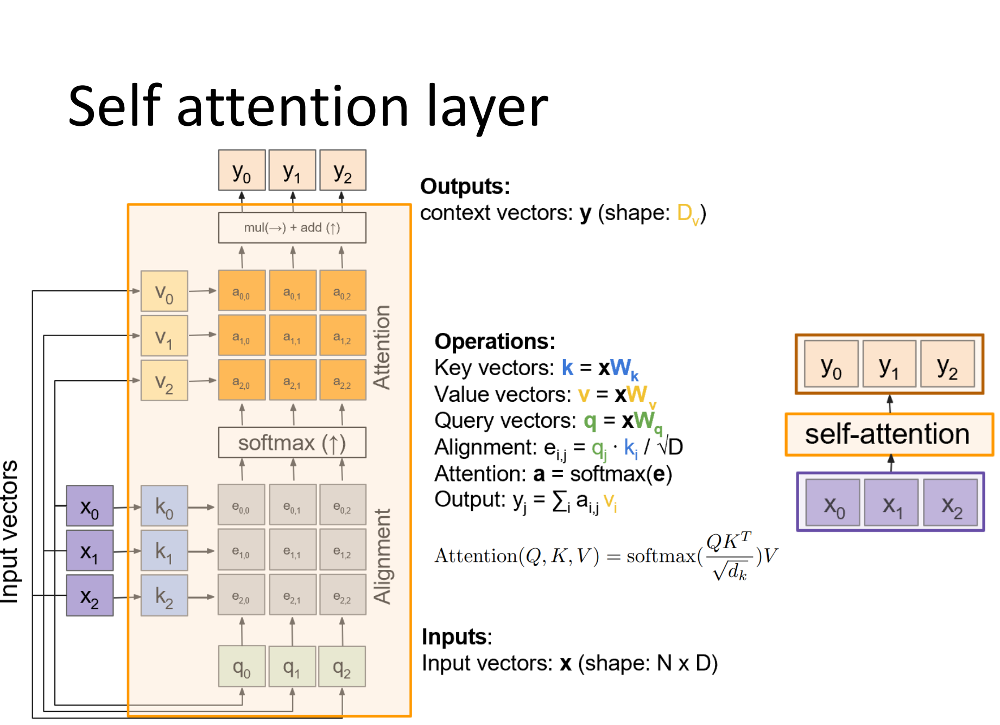

# Machine learning 笔记\-10 RL\&Transformer

# 强化学习

强化学习目标：学会采取动作，使长期期望奖励最大。

强化学习本质上也在学习一个函数，只不过这个函数输出的是 **动作**。

**稀疏奖励 sparse reward**。

**判断：强化学习中，每一步动作都会立即得到准确的正确答案。**

答案：错误。

强化学习中通常没有标准答案，只有 reward，而且 reward 可能延迟出现。

马尔可夫决策过程

系统需要决定：

> 哪些入境旅客需要检测，哪些不检测？
> 
> 

这涉及：

- 检测资源有限 

- 每个人风险不同 

- 检测有成本 

- 放行感染者有风险 

- 测试结果可能延迟 24–48 小时 

这类问题可以看作：

强化学习不只用于游戏，也可以用于医疗、公共卫生、交通、推荐系统等。

# Transformer

上半部分是encoder，负责理解输入序列，下半部分是decoder 负责根据编码器encoder的理解一步步生成输出序列

输入序列，由于神经网络不能直接处理文字，所以第一步要把文字变成向量也就是input embedding，把每个token变成一个向量，一句话就变成了一个向量序列，通常维度很高。

Transformer 需要加上位置编码。

## encoder

输入表示=词向量\+位置编码

图中 Input Embedding 后面有一个加号，旁边是 Positional Encoding，意思就是：

> 把词的语义信息和位置信息加在一起。
> 
> 

Encoder Block 会重复堆叠 N 次。每个encoder block 通常有两个子层：**Multi\-Head Attention和Feed Forward**

并且每个子层后面都有：Add \& Norm

encoder中多头自注意力模块并行做多次自注意力，多个头结果拼接实际上是聚合学习

ADD\&NORM: ADD\-残差连接 深层网络在训练时容易丢失原始信息，也容易梯度消失，残差链接可以让模型在保留原始信息的基础上学习一个修正量，使得深层网络也可以被训练，并且缓解梯度消失速度

layernorm：对每个token的特征进行归一化（整理数值分布），让数值更加稳定，让训练更加稳定，更容易收敛。

Feed forward：又叫做FFN 或者MLP,对每个token的表示单独进行非线性加工， 

token 之间交流主要发生在 Self\-Attention 里面。

Feed Forward 是对每个位置分别做：

FFN\(xi\)

比如：FFN\(x\_1\), FFN\(x\_2\), FFN\(x\_3\), 

它不会直接计算 x1和 x2 的关系。

负责每个token自己内部进行更加复杂的特征变换

encoder输出结果：

经过

N 层 Encoder 之后，得到一组输出向量：\[c1,c2,c3,c4\]

## Decoder

output右移

Decoder block 解码器块内部主要有三个子层：

**1）Masked Multi\-Head Attention 让 Decoder 利用已经生成的内容，但不能偷看未来答案。\-目标序列内部交流**

**2）Multi\-Head Attention交叉注意力 cross attention让 Decoder 在生成输出词时，去参考 Encoder 对输入句子的理解。\-目标序列去看输入序列**

**3）Feed Forward 对每个位置的向量单独进行非线性变换**

每个子层后面也都有：

> Add \& Norm
> 
> 

位置编码要求：使用三角函数

