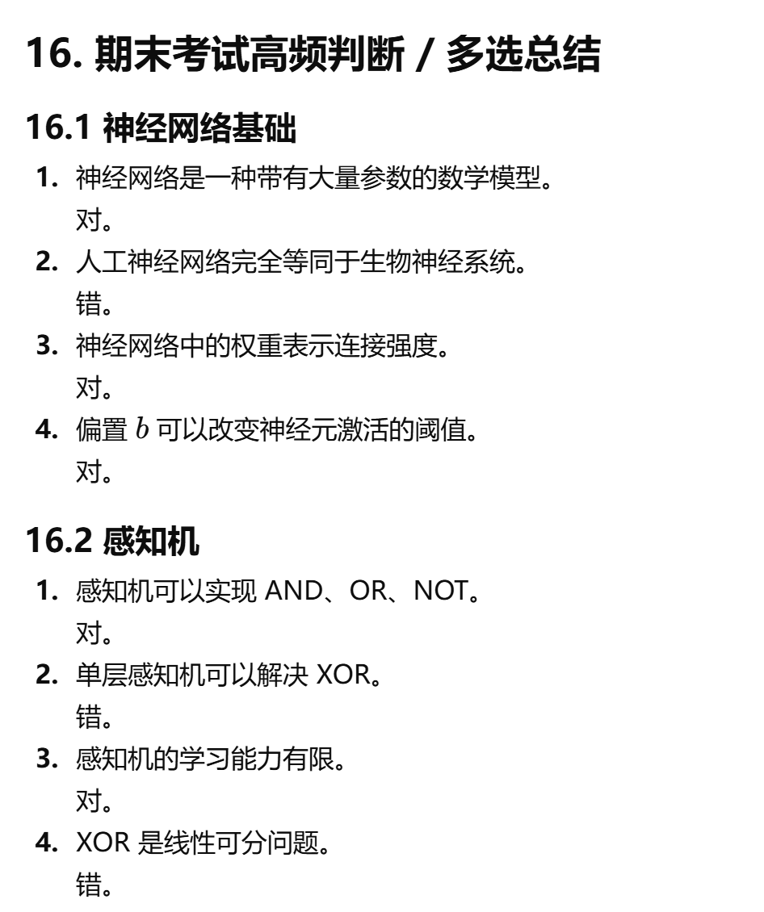

# Machine learning 笔记\-8 神经网络

神经网络历史参见课件

# 1\.神经元模型：

neuron 如果某 经元的电位超过了一个"阈值" （threshold）就会被激活，即兴奋起来，向其他神经元发送化学物质。

生物神经元大致包括：

- dendrite：树突，接收信号； 

- cell body：细胞体，整合信号； 

- axon：轴突，传递信号； 

- synapse：突触，连接神经元。

# 2\.激活函数

如果神经网络没有非线性激活函数，那么多层线性变换仍然等价于一层线性变换。激活函数的核心在于：引入非线性，使神经网络能够拟合复杂函数。

## 2\.1 Sigmoid

常用于二分类输出概率；但在深层网络中容易出现梯度消失,当 Sigmoid 输入很大或很小时，曲线变得很平，导数接近 0，参数更新会非常慢。

输出范围（0，1）

## 2\.2 tanh

输出范围（\-1，1）

相比 Sigmoid，tanh 以 0 为中心，训练时有时更稳定，但也可能出现梯度消失

## 2\.3 Relu

ReLU\(x\)=max\(0,x\)

优点：计算简单，能缓解梯度消失，在深度学习中非常有效，

缺点：当输入长期小于 0 时，该神经元输出一直是 0，可能出现 “dead ReLU” 问题。

## 2\.4 Leakly Relu

LeakyReLU\(x\)=max\(0\.1x,x\)

和 ReLU 的区别是：

- ReLU 在负数区域输出 0； 

- Leaky ReLU 在负数区域保留一个很小的斜率。 

这样可以减少神经元“死亡”的问题。

## 2\.5Elu

在负数区域不是直接变成 0，而是平滑下降。

## 2\.6 Maxout

max\(w1Tx\+b1,w2Tx\+b2\)

可以学习更加灵活的分段函数，但参数量可能更大。

# 3\.神经网络结构

## 3\.1 感知机：perceptron

由两层神经元组成，输入层接收外界输入信号后传递给输出层，输出层是阈值逻辑单元（threshold logic unit）

感知机可以看作：

如果 score 大于阈值，就输出“通过”；否则输出“不通过”。

这就是一种线性边界判断。

要解决非线性可分问题，需考虑使用多层功能神经元\.例如图5\.5中这个简单的两层感知机就能解决异或问题\.在图5\.5\(a\)中，输出层与输入层之间的一层神经元，被称为隐层或隐含层\(hiddenlayer\)，隐含层和输出层神经元都是拥有激活函数的功能神经元\.

## 3\.2 多层神经网络

多层前馈神经网络一定是多层神经网络；

但多层神经网络不一定都是前馈神经网络。

注意前馈forward表示网络结构和计算方向，输入数据从前往后流动，最终得到输出。预测时：x→h→y  前馈并不是指网络中信号不能向后传，而是指网络拓扑结构上不存在环或者回路。

反向传播backpropagation 是指训练时如何计算梯度，训练时：

Loss→输出层→隐藏层→输入方向 误差从后往前传递，使用链式法则计算每个参数的梯度。

**多层神经网络**：强调“层数多”，是一个宽泛概念。
**多层前馈神经网络**：强调“多层 \+ 信息单向向前传播 \+ 无循环连接”，是最经典的多层神经网络结构。
**多层感知机 MLP**：通常指由全连接层组成的多层前馈神经网络。

多层前馈神经网络 multi\-layer feedforwrd neural networks 有几个特点：

1. 有多层结构； 

2. 信息单向流动； 

3. 每一层通常只连接到下一层； 

4. 同一层神经元之间没有连接； 

5. 不存在循环连接； 

6. 常见形式是全连接网络。（mlp）

两层神经网络/单隐藏层

三层神经网络/双隐藏层

“2\-layer Neural Network” 一定包含两个隐藏层。错。通常它表示一个隐藏层加一个输出层，也就是有两层带权重的计算层。

从更一般的神经网络概念看

**多层前馈神经网络不一定每层都全连接。**

只要它满足：

输入→中间层→输出输入 \\rightarrow 中间层 \\rightarrow 输出输入→中间层→输出

信息单向传播，没有循环连接，就可以叫前馈网络。

例如 CNN 卷积神经网络也是前馈的，但它不是全连接。

CNN 中，一个卷积核只看输入图像的一小块区域，不会让每个输入像素都连接到下一层每个神经元。

所以 CNN 是：前馈网络前馈网络前馈网络，但不是：全连接网络全连接网络全连接网络。

**Fully connected layers 全连接层**

前一层的每个神经元都连接到后一层的每个神经元，

例如上一层有 3 个神经元，下一层有 4 个神经元，那么连接权重有：

3×4=12

如果加上每个输出神经元的偏置，还要再加 4 个 bias。

作用：

1）综合所有特征

比如手写数字识别中，前面层可能已经提取出了这些特征：

- 上方是否有弯曲； 

- 中间是否有横线； 

- 下方是否有闭合； 

- 左右是否对称。 

全连接层会把这些特征综合起来判断：

> 这些特征组合起来，更像数字 2，还是数字 8？
> 
> 

所以全连接层常用于模型后半部分，尤其是分类前的综合判断阶段。

2）改变特征维度，

全连接层可以把一个维度的向量变成另一个维度的向量。

例如手写数字图片输入是 16×16，展开后是：

256维

经过一个全连接层可以变成：

256→100

再经过输出层变成：

100→10

其中 10 就对应数字 0 到 9 的 10 个类别。

所以全连接层可以起到：

> 特征压缩、特征变换、映射到输出类别空间的作用。
> 
> 

3）学习特征之间的组合关系

全连接层的作用是将上一层所有神经元的输出进行加权求和，并通过偏置和激活函数得到新的特征表示。它可以综合全局特征、改变特征维度、学习特征之间的组合关系，并常用于神经网络末端完成分类或回归预测。

## 3\.2 神经网络学习的本质

学习过程就是根据训练数据调整神经元之间的连接权重和每个功能神经元的阈值。

神经网络的学习过程，就是根据训练数据调整神经元之间的连接权重和每个功能神经元的阈值，权重 W 决定输入的重要性，偏置 b 决定激活阈值的偏移。

深度网络特别适合图像、语音、自然语言等复杂数据，可以逐层学习更加复杂的特征。

Are more layers in a neural network better?不一定，更多层会可能带来更强的表达能力，但是

参数更多，容易过拟合；训练更困难；计算成本更高；可能出现梯度消失或梯度爆炸；数据量不够时，深层网络不一定表现更好，而是要结合数据规模、任务复杂度、计算资源和网络设计。

# 4\.神经网络如何工作

因为神经网络中有大量神经元和参数，如果一个一个算，会非常慢。

矩阵运算可以利用并行计算，例如 GPU 加速。

课件中也提到：

> Using parallel computing techniques to speed up matrix operation
> 
> 

也就是说，神经网络能快速训练，很大程度上依赖矩阵运算和并行计算。

神经网络可以作为 multi\-class classifier 多分类器。

Feature extractor replacing feature engineering

神经网络的隐藏层可以自动提取特征，从而在一定程度上替代人工特征工程。

如何确定网络结构：

> How many layers? How many neurons for each layer?
>  Trial and Error \+ Intuition
> 
> 

意思是：

- 层数多少； 

- 每层多少神经元； 

- 用什么激活函数； 

- 学习率多少； 

- batch size 多大； 

这些通常不是直接从公式推导出来的，而是结合经验、任务特点和实验调参。这些被称为 **超参数 hyperparameters**。

# 5\.神经网络优化

模型训练需要最小化损失函数，但是神经网络可能有几百万甚至几亿个参数，直接逐个求导，计算量巨大，反向传播的作用是高效计算梯度，反向传播不是直接“更新参数”的算法，它主要负责算梯度。

真正更新参数的是梯度下降或其他优化器，例如 SGD、Adam 等。

核心：链式法则

步骤：

反向传播就是：

1. 前向传播：从输入算到输出； 

2. 计算损失； 

3. 从输出反向传回去； 

4. 每一步用链式法则计算梯度。 

> 反向传播 = 上游梯度 × 局部梯度。
> 
> 

\[upstream gradient\]\*\[local gradient\]

加法节点：会把上有梯度原样传递给两个输入

乘法节点：

q=xy

乘法节点反传时：

- 对 x的梯度等于上游梯度乘以 y； 

- 对 y的梯度等于上游梯度乘以 x。

