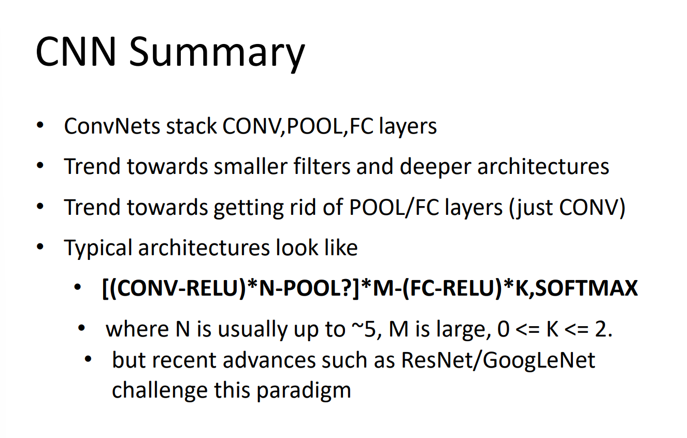

# Machine learning 笔记\-9 CNN

ResNet 和 GoogLeNet 不只是简单一层接一层。

ResNet 引入了残差连接 shortcut connection

普通网络是：

x→F\(x\)

ResNet 是：

x→F\(x\)\+x

优势：

缓解梯度消失；让网络可以做得非常深；训练更容易。

GoogLeNet 的特点：

GoogLeNet 使用 Inception 模块。

它会在同一层中并行使用不同大小的卷积核，比如：

1×1,3×3,5×5然后把结果拼接起来。

思考题：

• Why do we introduce a max pooling layer instead of using a convolutional layer with a larger stride? 

Max pooling 是一种无参数的下采样方法，它通过取局部最大值保留最显著特征，减少特征图尺寸和计算量，并增强局部平移不变性。虽然使用更大 stride 的卷积层也可以下采样，但它会引入额外可学习参数，计算更复杂，也可能增加过拟合风险。因此，传统 CNN 常使用 max pooling 作为简单有效的下采样方法。

Max pooling 的作用：下采样，减少计算，无参数，保留局部最大响应值，且增强了局部平移鲁棒性。

• What are the advantages of convolutional layers over fully connected layers for image classification?

卷积层相比全连接层更适合图像分类，因为卷积层保留了图像的空间结构，通过局部连接利用图像的局部相关性，通过参数共享大幅减少参数数量，并且可以在不同位置检测同一种特征，具有一定的平移鲁棒性。此外，多层卷积可以逐步学习从低级到高级的层级特征，因此在图像任务中通常比全连接层更有效。

