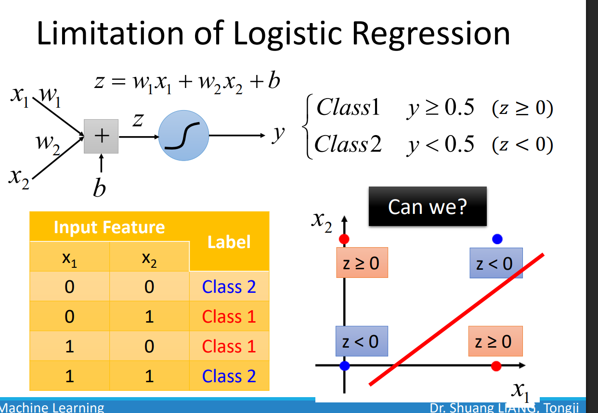

# Machine learning笔记\-4逻辑回归

# 分类器类型

首先将分类器分为两大类：

## 1\. Model‑based（基于模型）

- 这类方法会显式地学习一个参数化模型（例如线性边界、概率分布参数）。

- 模型一旦训练完成，预测时不再需要原始训练数据。

### 1\.1判别模型（Discriminative Model）

直接学习决策边界或条件概率 P\(y∣x\)，不关心数据 x 本身是如何生成的。

- 做法：给定输入 x，直接建模输出 y的概率/输出决策标签

- 当数据分布非常复杂（如文本、图像、电影评分等）时，判别模型通常表现更好，因为它不浪费建模能力去描述 x的分布。

- 直接优化分类准确率。

- 关注点：找到准确清晰的估计决策规则/边界

- 举例：逻辑回归，决策树，神经网络

### 1\.2生成模型（Generative Model）

关注点：描述数据产生的完整机制

举例：

- 朴素贝叶斯（Naïve Bayes）

- 贝叶斯网络（Bayesian Networks）

- 隐马尔可夫模型（HMM，Hidden Markov Model）

优势：

天然处理缺失变量（某些特征缺失时仍可以进行推断）

更好的诊断能力

容易加入先验知识（例如对 P\(x∣y\)的形式进行人为设定）。

生成式模型缺点：

对数据的分布假设较强（例如朴素贝叶斯假设特征条件独立），如果假设错误，性能可能不如判别模型。

#### 生成式模型：

朴素贝叶斯：建模联合分布

HMM:隐马尔可夫模型

潜在狄利克雷分配（LDA）可以生成文档，变分自编码器（VAE）

生成对抗网络（GAN）

## 2\. No Model（无模型）

- 没有显式的训练过程，不学习固定的参数。

- 直接使用所有（或部分）训练样本进行预测。

- 典型代表：KNN（K‑近邻）k\-means。

- 优势：简单、无需训练、可适应任意分布。

- 劣势：预测慢、存储开销大；对噪声和距离度量敏感。

### 实际选择指南：

- 数据分布极复杂且维度高（如图像） → 判别模型（深度网络）。

- 需要处理缺失数据或加入领域知识 → 生成模型（贝叶斯网络）。

- 数据量小、没有训练时间、需要快速原型 → KNN。

- 对可解释性要求高 → 决策树（判别）或朴素贝叶斯（生成）。

Rather than modeling the output y directly, we can model the probability that x belongs to a particular category\.

# sigmoid 函数

将无限范围的数值压缩到一个有限的概率空间。

$\sigma(z) = \frac{1}{1 + e^{-z}}$

其中，z 是输入。在逻辑回归中，z 通常是线性回归的输出：$z = \mathbf{w}^T\mathbf{x} + b$。

$\frac{d}{dz}\sigma(z) = \sigma(z)(1 - \sigma(z))$

> **解读：** 不需要重新计算复杂的指数函数，只需要用预测出来的结果 $\hat{y}$ 算一下$\hat{y}(1-\hat{y})$
> 
> 且中心对称
> 
> 

### Sigmoid的缺点（深度学习中很少使用）

虽然在逻辑回归中它是主角，但在深度神经网络（如 CNN、Transformer）的中间隐藏层中，Sigmoid 已经逐渐被 **ReLU** 取代，原因如下：

- **梯度消失 ****\(Gradient Vanishing\)：** 观察 S 型曲线的两端，函数非常平坦。这意味着当输入$z$ 很大或很小时，导数 $\sigma'(z)$ 趋近于 0。在深层网络中，这会导致梯度无法传导，模型“练不动”。

- **非零中心化 \(Not Zero\-centered\)：** 输出全是正数，这会导致下一层神经元的输入分布发生偏移，减慢收敛速度。

- **指数计算开销：** 相对于简单的 $max(0, x)$（ReLU），$e^{-z}$ 的计算相对费时。

# Step1: Function Set

模型首先对输入特征 $\mathbf{x}$ 进行加权求和，并加上偏置项 $b$，得到一个位于实数域 $(-\infty, +\infty)$ 的线性预测值 $z$：

$z = \sum_{i} w_i x_i + b = \mathbf{w}^T \mathbf{x} + b$

在学术语境下，$z$ 常被称为**对数几率 \(Logit\)**。

为了将 $z$转换为符合概率公理（即在$[0, 1]$ 区间内）的数值，我们引入 **Logistic Function（Sigmoid 函数）** $\sigma(z)$ 作为激活函数：

$f_{\mathbf{w},b}(\mathbf{x}) = p(1|\mathbf{x}) = \sigma(z) = \frac{1}{1 + \exp(-(\mathbf{w}^T \mathbf{x} + b))}$

此时，模型直接输出的是样本属于正类（Class 1）的条件概率。

二分类模型在定义了 $p(1|x)$ 后，负类（Class 0）的概率随之确定：

$p(0|\mathbf{x}) = P(Y=0|X=\mathbf{x}) = 1 - \sigma(\mathbf{w}^T \mathbf{x} + b) = \sigma(-(\mathbf{w}^T \mathbf{x} + b))$

$z$ 的量值（Magnitude）与模型**置信度 \(Confidence\)** 的相关性

**高置信度区域 \(High Confidence\)：**

- 当 $\mathbf{w}^T \mathbf{x} + b \gg 0$ 时，$p(1|x) \to 1$。

- 当 $\mathbf{w}^T \mathbf{x} + b \ll 0$时，$p(1|x) \to 0$。

- **几何解释：** 这代表样本点远离**决策超平面**，模型对于分类结果非常确定。

**低置信度区域 \(Low Confidence\)：**

- 当 $\mathbf{w}^T \mathbf{x} + b \approx 0$ 时，$p(1|x) \approx 0.5$。

- **几何解释：** 样本点位于决策边界附近，处于分类的模糊地带，模型此时表现为“犹豫不决”。

### 预测标签的量化 \(Quantization of Probability\)

虽然函数集输出的是连续的概率值，但在实际应用中我们需要给出离散的标签输出。这通过量化（Thresholding）实现：

$\hat{y} = \begin{cases} 1 & \text{if } p(1|\mathbf{x}) \geq 0.5 \\ 0 & \text{if } p(1|\mathbf{x}) < 0.5 \end{cases}$

对应的决策边界即为超平面$\mathbf{w}^T \mathbf{x} + b = 0$。

# Step2: Goodness of a function 

最大似然估计 \(Maximum Likelihood Estimation, MLE\)

### 单个样本的概率表达

对于任意样本 $x^n$，模型给出的预测是属于类别 $C_1$ 的概率 $f_{w,b}(x^n)$。利用二项分布（伯努利分布）的特性，我们可以将样本出现的概率统一为一个简洁的表达式：

$P(y^n | x^n; w, b) = (f_{w,b}(x^n))^{y^n} \cdot (1 - f_{w,b}(x^n))^{1-y^n}$

- 当真实标签 $y^n = 1$ 时，表达式简化为 $f_{w,b}(x^n)$。

- 当真实标签 $y^n = 0$ 时，表达式简化为 $1 - f_{w,b}(x^n)$。

### 似然函数的构建

假设训练集中的$N$ 个样本是**独立同分布 \(IID\)** 的，那么模型生成整个数据集的联合概率即为所有样本概率的累乘：

$L(w, b) = \prod_{n=1}^{N} P(y^n | x^n; w, b)$

**学术含义：** 似然函数衡量的是：在当前的参数 $(w, b)$ 下，观察到这组真实标签序列的概率有多大。我们的目标是找到一组参数，使得这个概率最大化（即 **MLE**）。

直接对似然函数L\(w, b\) 求最大值存在两个问题：**求导极其困难**：乘法的链式法则会产生海量的项。且趋近于0，超出计算机浮点数的精度范围

### 取对数 \(Log\-likelihood\)

利用对数函数的单调性，$\arg\max L(w, b)$ 等价于 $\arg\max \ln L(w, b)$：

$\ln L(w, b) = \sum_{n=1}^{N} \left[ y^n \ln f_{w,b}(x^n) + (1-y^n) \ln (1-f_{w,b}(x^n)) \right]$

机器学习习惯于使用“损失函数”并进行**最小化**。因此我们给上式加上负号，得到**负对数似然 \(NLL\)**：

$- \ln L(w, b) = \sum_{n=1}^{N} - \left[ y^n \ln f_{w,b}(x^n) + (1-y^n) \ln (1 - f_{w,b}(x^n)) \right]$

y^n表示的并不是预测值，是某个样本对类别c的真实标签1\-hot标签 （1或者0）

交叉熵 \(Cross\-Entropy\)

### 两个分布的差异

对于每个样本 $x^n$ ，存在两个分布：

- **真实分布 **$p$：由真实标签$y^n$ 决定，$p(1)=y^n, p(0)=1-y^n$。

- **预测分布 **$q$：由模型输出决定，$q(1)=f(x^n), q(0)=1-f(x^n)$。

### 交叉熵的定义

交叉熵 $H(p, q)$ 衡量的是用分布 $q$ 来表示分布 $p$ 时所需的平均信息量。在分类任务中，它直接描述了**模型预测分布偏离真实分布的程度**：

$H(p, q) = -\sum_{i} p_i \ln q_i = - [y^n \ln f(x^n) + (1-y^n) \ln (1-f(x^n))]$

### 结论

逻辑回归的负对数似然函数，在形式上完全等同于所有训练样本的**交叉熵之和**。

> **最小化交叉熵 = 最大化似然 = 寻找最符合数据观测规律的参数。**
> 
> 

## 为什么不使用线性回归的 MSE（均方误差）？

这是一个经典的考点。如果我们在逻辑回归中使用 

$L = \sum (y^n - f(x^n))^2$

1. **非凸性 \(Non\-convexity\)**：MSE 配合 Sigmoid 函数会产生大量的局部最小值和鞍点，梯度下降极易卡死。

2. **梯度消失**：当预测值极其错误（例如 $y=1$ 但 $f(x)=0$）时，MSE 的梯度会变得非常小，导致模型“拒绝学习”。

3. **交叉熵的优越性**：交叉熵的导数具有 $
\hat{y} - y$的简洁形式，当误差越大时，梯度越大，收敛极快。

**MSE 的困境：**$\sigma'(z)$在 $z$ 很大或很小时会趋近于 0（即 Sigmoid 的**饱和区**）。这意味着如果模型预测错了且错得很离谱，梯度反而会变得极小，导致模型“拒绝学习”。

**交叉熵的优越性：** 当你对负对数似然（交叉熵）求导时，复杂的链式法则中 $\sigma'(z)$ 项会被分母项完美**抵消（Cancel out）**。

# Step3:Find the best function

$- \ln L(w, b) = \sum_{n=1}^{N} - [ \hat{y}^n \ln f_{w,b}(x^n) + (1 - \hat{y}^n) \ln (1 - f_{w,b}(x^n)) ]$

其中 $f_{w,b}(x^n) = \sigma(z) = \frac{1}{1+e^{-z}}$，

且 $z = \sum w_i x_i + b$。

求偏导

$\frac{\partial (-\ln L)}{\partial w_i} = \sum_{n} - ( \hat{y}^n - f_{w,b}(x^n) ) x_i^n$

梯度下降规则：

$w_i \leftarrow w_i - \eta \frac{\partial (-\ln L)}{\partial w_i}$

代入推导结果：

$w_i \leftarrow w_i - \eta \sum_{n} - ( \hat{y}^n - f_{w,b}(x^n) ) x_i^n$

$\eta$：学习率，控制更新步长。

$-(\hat{y}^n - f_{w,b}(x^n))$：

这其实就是 $f_{w,b}(x^n) - \hat{y}^n
$** **，即“预测值与真实值的差”。

$x_i^n$：第 $n$ 个样本的第 $i$ 个特征。

# 总结：

# Logistic Regression vs Linear Regression

# 逻辑回归的优势

1\.No prior assumptions about data distribution

对数据分布无先验假设

**学术解释：** 相比于生成模型（如朴素贝叶斯或 LDA 假设特征服从高斯分布），逻辑回归是**判别模型**。它直接建模 $P(Y|X)$，不关心特征 X 是如何生成的。

**直观意义：** 无论你的特征是正态分布、偏态分布还是杂乱无章的分布，逻辑回归都能直接在特征空间寻找分界线。这使得它在处理未知分布的数据时比生成模型更具**鲁棒性**。

2\.Useful for tasks that require probabilities to make decision

适用于需要概率辅助决策的任务

**学术解释：** 逻辑回归输出的是一个连续的概率值 $P(Y=1|X) \in (0, 1)$。

**直观意义：** 在很多场景下，我们不仅需要知道“是或否”，还需要知道“多大概率是”。

- **例子：** 在医疗诊断中，告诉医生“患者患病概率为 99%”与“51%”的意义完全不同。概率值能为风险评估和后续的阈值调整（Thresholding）提供核心依据。

3\.Sigmoid is a derivable convex function of any order, and it is easy to find the optimal solution

准确来说，逻辑回归的**负对数似然损失函数（Cross\-Entropy）是关于参数 **$w, b$**的凸函数 \(Convex Function\)**。

> The sigmoid function is smooth and differentiable, but it is not globally convex\. In logistic regression, the negative log\-likelihood, also known as the cross\-entropy loss, is convex with respect to the parameters www and bbb\. Therefore, gradient\-based optimization methods can reliably converge to a global optimum under suitable conditions\.
> 
> Sigmoid 函数本身光滑且可导，但并不是全局凸函数。逻辑回归真正具有凸性的是关于参数 w,b的负对数似然损失函数，也就是交叉熵损失。因此，在适当条件下，逻辑回归优化问题不存在坏的局部最优，梯度下降等方法可以收敛到全局最优。
> 
> 

**直观意义：**

- **可导性：** 意味着我们可以直接使用高效的梯度下降算法。

- **凸性：** 保证了函数没有局部最优解（Local Minima），只有一个**全局最优解**。无论你从哪里开始初始化权重，只要学习率合适，最终都能收敛到同一个最好的模型。这对于工程实践中的稳定性至关重要。

# 逻辑回归的限制

### 线性决策边界的限制 \(Linear Boundary Constraint\)

- **核心痛点：** 逻辑回归本质上是在空间中画一条“直线”（或超平面）。

- **失效场景：** 如果数据的分类界限是复杂的非线性形状（如圆形、环形或著名的 **XOR（异或）问题**），逻辑回归无法通过单条直线将其分开。

- **表现：** 无论怎么训练，模型在处理非线性可分数据时的准确率都会遇到瓶颈。

### 极其依赖特征工程 \(Heavy Reliance on Feature Engineering\)

- **核心痛点：** 既然它只能画直线，如果想处理非线性问题，就必须由人工手动进行特征组合（如引入 $x^2$、$x_1x_2$ 等）。

- **后果：** 这需要极高的业务经验。相比之下，深度学习或支持向量机（SVM）可以通过多层网络或核函数自动捕获这些非线性关系，而逻辑回归必须由人类“喂”给它复杂的特征。

### 3\.容易欠拟合 \(Underfitting\)

- **核心痛点：** 逻辑回归是一个“低方差、高偏差”的模型。

- **表现：** 它的模型容量（Capacity）有限。在处理海量、高维度且模式复杂的任务（如图像识别、自然语言理解）时，它的表现远不如深层神经网络，因为它无法捕获特征之间深层的非线性关联。

**无法自动发现规律 \(No Automatic Discovery\)：**

逻辑回归自己不会发明“到 $[0,0]$ 的距离”这种新特征。它只会傻傻地在给定的特征上画线。如果特征给得不好，它就表现得“无能为力”。

**特征设计的艰巨性 \(Not Always Easy\)：**

在这个例子里只有 4 个点，你可以一眼看出可以算距离。但在实际工程中，数据可能有几千个维度，**你几乎不可能通过肉眼或简单逻辑找到那个能让数据变线性的转换公式。**

**对领域知识的依赖 \(Domain Knowledge Requirement\)：**

正如课件最后提到的，你需要非常了解你的数据（Domain Knowledge），才能设计出有效的特征转换。

- *例如：* 处理地理位置数据时，你可能需要手动把经纬度转成“到市中心的距离”，模型才好用。

