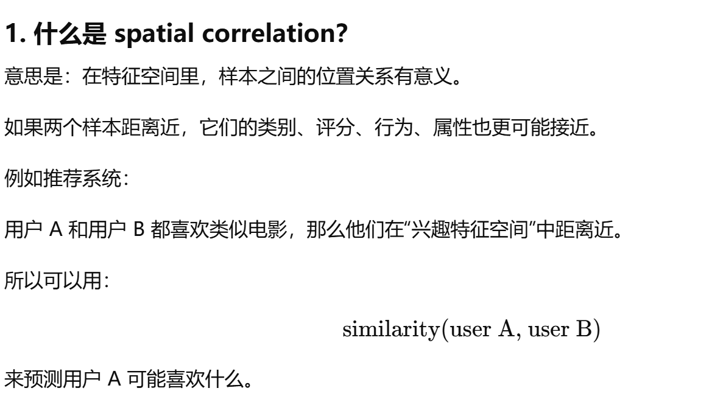

# Machine learning笔记\-5 KNN

• Requires the definition of a distance function or similarity measures between samples

• Select the class based on the majority vote in the k closest points

# Step1: Find nearest neighbors

$nbh_{STrain,k}: \mathcal{X} \to \mathcal{X}^k$ 描述了寻找邻域的过程：

- $\mathcal{X}$** \(域/空间\)**：代表原始的特征空间。输入是一个待查询的样本向量 $x$。

- $\mathcal{X}^k$** \(目标集合\)**：代表从训练集 $STrain$ 中选出的 $k$ 个元素的集合。

- $x \mapsto \{ \dots \}$：这表示一个映射规则，即将输入点 $x$ 映射为距离它最近的 $k$ 个训练样本点

如何定义举例：

常使用 **闵可夫斯基距离 \(Minkowski Distance\)** 这一通式来定义：

$d(x, y) = \left( \sum_{i=1}^{n} |x_i - y_i|^p \right)^{1/p}$

根据参数 $p$ 的不同，衍生出几种最常用的距离：

欧几里得距离 \(Euclidean Distance, $p=2$\)

曼哈顿距离 \(Manhattan Distance, $p=1$\)

- **适用：** 当特征具有高维稀疏性，或者特征之间的差异具有离散累计特性时。

### 常见的平局处理策略 \(Tie\-breaking Strategies\)

课件中提到的“取决于策略（Depend on the strategy）”，通常指以下几种工程处理手段：

#### A\. 随机选择 \(Random Selection\) —— 课件提及的方法

- **做法：** 从距离相等的样本中随机抽取一个。

- **评价：** 简单，但在相同的数据上多次运行可能会得到不同的分类结果，导致模型缺乏**确定性（Determinism）**。

#### B\. 索引顺序 \(Index Order\)

- **做法：** 选取在数据集中排列靠前的样本。

- **评价：** 具有确定性，但这种确定性是随机且无意义的（取决于数据录入的顺序）。

#### C\. 包含所有平局点 \(Include All\)

- **做法：** 如果 $k=1$ 且有 3 个点平局，则干脆将这 3 个点都视为邻居进行投票。

- **评价：** 此时实际的 $k$ 会大于设定的 $k$。这种方法更公平，但会增加计算开销。

#### D\. 权重细分 \(Weight Refinement\)

- **做法：** 如果距离相等，尝试引入第二个衡量标准（例如：该类别的先验概率，或者看这些点周围的密度）。

For the binary case it is good to pick k to be odd so that there is a clear winner\.

# Step2:Select Class \(majority vote\)

> 什么是Hyperparameters
> 
> **"Choices about the algorithm that we set rather than learn\."**
> 
> （由我们设定而非通过学习得到的算法选项。）
> 
> 

- **参数 \(Parameters\)：** 模型在训练过程中自动优化的量（如逻辑回归的 $w$ 和 $b$）。

- **超参数 \(Hyperparameters\)：** 在训练开始前，必须由人类指定的“配置参数”（如 KNN 的 $k$ 和距离公式）。

## 如何选择最好的 $k$ 值？

$k$ 的选择本质上是在进行**偏置\-方差权衡 \(Bias\-Variance Tradeoff\)**：

- $k$** 越小：** 模型越复杂。

    - *优点：* 对局部细节非常敏感，能捕捉细微特征。

    - *缺点：* 容易受到训练集中**噪声**的影响（即过拟合 Overfitting）。如果有一个异常点，极小的 $k$ 会被它带偏。

- $k$** 越大：** 模型越平滑。

    - *优点：* 鲁棒性强，不易受单点干扰。

    - *缺点：* 可能会模糊掉不同类别之间的边界（即欠拟合 Underfitting）。

- **经验法则：** 通常尝试 $\sqrt{N}$（$N$ 为样本数）附近的奇数，但这仅仅是一个起点。

## 如何选择最好的距离度量？

距离公式决定了你如何看待数据的“相似性”。

- **欧氏距离 \(**$L_2$**\)：** 适合各维度量纲统一、分布较为集中的数据。

- **曼哈顿距离 \(**$L_1$**\)：** 适合高维空间或各维度物理意义差异较大的情况。

- **为什么要试？** 因为数据在多维空间里的分布（Geometry）是肉眼看不见的。有时候 $L_1$ 比 $L_2$ 更能反映真实的类别差异，这完全取决于具体的业务数据。

原因：

### A\. 计算开销极其巨大 \(Computational Cost\)

这是最现实的原因。

- **机器学习：** 训练一个 KNN 或逻辑回归可能只需要几秒或几分钟。做 5\-折交叉验证也才几分钟。

- **深度学习：** 训练一个大型神经网络（如 ResNet, Transformer）可能需要几天甚至几周，耗费大量的 GPU 算力。

    - 如果你做 5\-折交叉验证，意味着你需要把这个漫长的过程**重复 5 次**。

    - **结论：** 时间成本和经济成本（电费、算力费）太高，通常难以承受。

### B\. “大数据”带来的稳定性 \(Data Abundance\)

深度学习通常建立在海量数据的基础上（数万到数亿量级）。

- **大数定律：** 当数据量足够大时，随机切分出的一个验证集（比如 10% 的数据）通常已经能够代表整体的数据分布。

- **结论：** 在大数据下，单次验证的结果已经足够稳定，不再需要通过多次折叠来消除随机性。

### C\. 超参数调优的复杂度 \(Hyperparameter Complexity\)

深度学习有大量的超参数（学习率、层数、Batch Size、Dropout 等）。

- 调参通常使用网格搜索（Grid Search）或随机搜索。如果每个参数组合都要跑一遍 $k$\-折交叉验证，实验次数会呈指数级爆炸。

- *例子：* 10 组参数组合 $\times$ 5\-折交叉验证 = 50 次完整的深度学习训练。这在工程上几乎不可行。

### D\. 模型收敛的随机性

深度学习的训练过程包含很多随机因素（权重初始化、数据洗牌等）。

- 比起交叉验证带来的那一点点评估精度提升，研究者通常更倾向于把这些算力用来尝试**不同的模型架构**或**更大的数据集**。

以下是针对 $N$ 个样本、每个样本 $D$ 个特征的情况进行的复杂度拆解：

---

### 训练阶段 \(Training\)

- **速度：极快（接近瞬时）**

- **复杂度：**$O(1)$** 或 **$O(N \cdot D)$

- **解释：** 在训练阶段，KNN 实际上**什么都不做**。它只是简单地把所有训练数据 $x$ 和标签 $$y$$ 存储在内存中。如果你认为“存入内存”也算时间，那就是 $O\(N \\cdot D\)$；但在算法层面，它没有数学推导，没有权重更新，所以被认为是 $O\(1\)$。

### 预测阶段 \(Prediction\)

- **速度：极慢**

- **复杂度：**$O(N \cdot D)$

- **解释：** 这是 KNN 最招人恨的地方。对于**每一个**新的测试样本，算法都必须执行以下步骤：

    1. **算距离：** 计算该样本与训练集中**所有 **$N$** 个**样本的距离。每一次距离计算需要 $D$ 次运算，总共 $O(N \cdot D)$。

    2. **找邻居：** 在所有距离中找出最小的 $k$ 个。如果使用堆排序，复杂度约为 $O(N \log k)$。

    3. **投个票：** 统计 $k$ 个邻居的类别。

- **最终瓶颈：** 由于 $N$ 通常远大于 $D$ 和 $k$，预测的复杂度主要由 $O(N \cdot D)$ 主导。

# Can we use KNN on images?

$L_2$（欧氏距离）计算的是每个像素点亮度的差异，而**像素的亮度并不等于图像的含义**。对图像进行平移/亮度变化，课件中说“三张截然不同的图到原图的 $L_2$ 距离可能一样”，

维度灾难 \(The Curse of Dimensionality\)当你把图像看作向量时，维度会迅速爆炸。一张普通的 $100 \\times 100$ 的彩色图片，其特征维度是 $100 \times 100 \times 3 = 30,000$ 维。

- **结果：** 在这种极高维的空间里，所有的样本点都变得极其**稀疏**。你几乎找不到任何“近邻”，或者说，**所有的点离你都一样远**。此时，KNN 这种依赖“最近邻”的逻辑就彻底失效了。

### 测试阶段的灾难性速度 \(Computational Cost\)

如前所述，KNN 的复杂度是 $O(N \cdot D)$。

- 对于图像来说，$D$（维度）是数万级。

- 如果你的训练集 $N$ 也是数万级。

- 每预测一张图片，电脑都要进行数亿次的浮点运算。这种效率无法满足任何实时识别的需求。

# 总结：

### 一、 核心优势 \(Strengths\)

- **实现简单且直观 \(Simple \& Intuitive\)：**

    - 它不需要复杂的数学推导（不像逻辑回归需要求导）。它的逻辑就是“看邻居”，这非常符合人类的直觉。

- **能学习非线性决策边界 \(Can learn non\-linear decision\)：**

    - 这是 KNN 优于逻辑回归的地方。逻辑回归默认只能画直线，而 KNN 的边界是根据数据点“包裹”出来的，它可以呈现出极其复杂的形状（如环形、螺旋形），无需手动做特征转换。

- **零训练时间 \(No Training Time\)：**

    - 它只是把数据存起来，不涉及任何参数更新。这在需要“即插即用”或频繁添加新训练样本的场景下非常方便。

### 二、 核心劣势 \(Weaknesses\)

- **预测复杂度随数据量 N 和维度 D 激增：**

    - **$N$ 的影响：** 样本越多，每次预测要算的距离就越多。

    - **$D$ 的影响：** 特征越多，单次距离计算就越慢。在高维空间下，不仅慢，还会遇到之前提到的“维度灾难”。

- **假设所有特征同等重要 \(Equal importance\)：**

    - **痛点：** 默认情况下，KNN 认为每个维度的 $1$ 单位距离都是等价的。

    - **风险：** 如果数据中有 10 个特征，其中 9 个是没用的噪声，KNN 依然会把这些噪声算进距离里，导致预测被带偏。

    - **对策：** 必须进行特征选择或特征缩放（Scaling）。

- **对异常值敏感 \(Sensitive to outliers\)：**

    - 尤其是当 $k$ 取值很小时（如 $k=1$），如果训练集里有一个标注错误的脏数据，它会直接导致周围的一片区域都被错误分类。

## 什么时候适合适用KNN：

## 不适合使用KNN：

KNN VS K\-MEANS

这两种都属于no\-model/非参数方法

**共同点**： 

- 都不假设数据的显式概率模型。 

- 都没有像线性回归、SVM那样的训练阶段产生参数模型。 

- KNN 预测时直接依赖存储的训练样本；K\-means 训练后主要依赖学习到的簇中心 centroids。

**最大差异**： 

- KNN 是**监督学习（或回归）**，依赖标签。 

- K\-means 是**无监督学习**，没有标签，聚类是基于距离的结构发现。

# K\-means 中的 K

在 K\-means 里：

K=簇（cluster）的数量K = \\text\{簇（cluster）的数量\}K=簇（cluster）的数量

意思是：

> 你希望把数据分成多少组。
> 
> 

