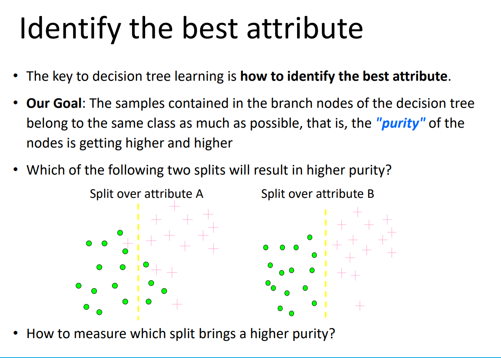
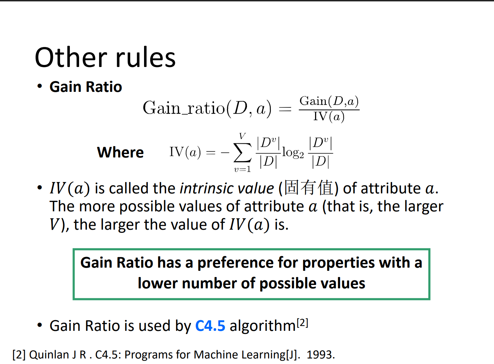
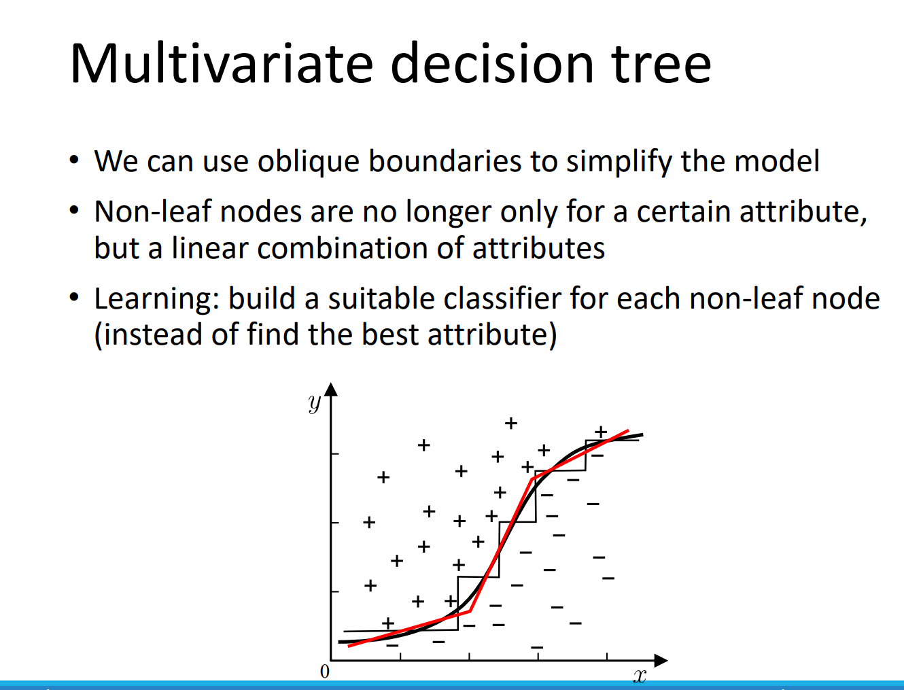

# Machine learning笔记\-6 Decision tree

决策树属于判别式分类器

优势：

1）最直观的分类器 \(Intuitive Classifiers\)

2）Easy to understand and construct

3）Surprisingly, also works very \(very\) well

# 决策树基本算法采用分治的递归思想

## 输入与输出

- 输入：

    - 训练集 `D = {(x₁, y₁), …, (xₘ, yₘ)}`，其中 `xᵢ` 是样本（属性值向量），`yᵢ` 是类别标签。

    - 属性集 `A = {a₁, …, a_d}`，每个属性可取离散值（此处假设为离散属性，连续属性需额外处理）。

- 输出：一棵以 `node` 为根结点的决策树。

## 递归函数 `TreeGenerate(D, A)`

#### 生成结点

- 创建当前结点 `node`（尚未标记类别或分支）。

#### 终止条件 \(1\)：当前结点包含的样本全属于同一类别

- 条件：`D` 中所有样本的类别标签 `y` 均相同，记为 `C`。

- 操作：将 `node` 标记为 C 类叶结点，并返回（不再继续分支）。

- 原因：此时无需再划分，该结点已“纯”。

#### 终止条件 \(2\)：属性集为空，或所有样本在剩余属性上取值相同

- 条件：`A = ∅`（没有可用属性可用来划分），或者 `D` 中所有样本在 `A` 的每个属性上取值完全相同（即无法通过任何属性进一步区分样本）。

- 操作：将 `node` 标记为 叶结点，类别标记为 `D` 中样本数最多的类（多数表决）。

- 原因：无法继续划分，只能以当前集合的统计信息作为预测结果。

#### 选择最优划分属性（关键步骤）

- 从 `A` 中选择一个最优划分属性 `a_*`（例如根据信息增益、增益率、基尼指数等准则）。

- 选择后，该属性将作为当前结点的 划分依据。

#### 对最优属性 `a_*` 的每个取值 `a_*^v` 生成分支  

假设 `a_*` 有 `V` 个可能取值 `{a_*^1, a_*^2, …, a_*^V}`，则对每个 `v = 1..V` 执行以下操作：

- 5\.1 生成一个分支，对应 `node` 的一个子结点。

- 5\.2 计算子集：令 `D_v` 为 `D` 中那些在属性 `a_*` 上取值为 `a_*^v` 的样本子集。

- 5\.3 处理子集为空的情况（终止条件 \(3\)）：

    - 若 `D_v` 为空，则将该分支结点标记为 叶结点，类别标记为 父结点集合 `D` 中样本数最多的类（注意不是 `D_v`，因为 `D_v` 为空）。

    - 之后返回（不再递归）。

- 5\.4 否则（子集非空）：

    - 递归调用 `TreeGenerate(D_v, A \ {a_*})`，即从属性集中移除已使用的属性 `a_*`，用剩余属性和子集 `D_v` 构建子树。

    - 将返回的子树作为该分支的子结点。

#### 输出根结点

- 递归结束后，返回以 `node` 为根结点的决策树。

## 三个终止条件的总结

算法在递归过程中遇到以下任一情况即停止生长当前分支，并将该结点标记为叶结点：

> 注意：条件 \(3\) 是在生成分支时判断的，而非在函数入口处；它处理的是某个属性取值在训练集中从未出现的情况。
> 
> 

# 核心定义：香农熵 \(Shannon Entropy\)

无论是哪种场景，基础公式永远是：

$Ent
(P) = -\sum_{i=1}^{n} p_i \log_2 p_i$

它衡量的是一个系统内部的**不确定性**

### 在决策树中：信息熵 = 内部的“纯度”

在决策树（如 ID3 算法）里，我们关注的是**单一概率分布**。

- **场景：** 针对一个结点里的标签集合（比如 10 个样本，5 正 5 负）。

- **物理意义：** 这个集合的“混乱程度”。如果正负各半，熵最大（最混乱）；如果全是正类，熵为 0（最纯净）。

- **用途：** 评估“这一刀切下去，子集是否变得更纯了”。我们通过计算**信息增益（Information Gain）**，即“划分前后的熵差”，来决定最优属性。

### 在逻辑回归中：交叉熵 = 分布间的“距离”

正如你所说，逻辑回归涉及的是**两个概率分布**之间的关系。

- **两个分布：**

    1. **真实分布 **$p$**：** 标签的真实值（通常是 0 或 1）。

    2. **预测分布 **$q$**：** 模型输出的概率 $f_{w,b}(x)$。

- **数学形式（交叉熵 Cross\-Entropy）：**

- $H(p, q) = -\sum p_i \log_2q_i$

- **物理意义：** 衡量预测分布 $q$ 偏离真实分布 $p$ 的程度。

# 信息增益Information Gain ID3

信息增益（Information Gain）是决策树（如 ID3 算法）选择特征的**核心指标**。简单来说，它衡量的是：**在知道某个属性的取值后，系统的不确定性降低了多少？**

**数学本质：** 原始数据的总熵 $Ent(D)$ 减去按属性 $a$ 划分后的加权期望熵。

假设属性 $a$ 有 $V$ 个可能的离散取值 $\{a^1, a^2, \dots, a^V\}$。

$Gain(D, a) = \underbrace{Ent(D)}_{\text{划分前的熵}} - \underbrace{\sum_{v=1}^{V} \frac{|D^v|}{|D|} Ent(D^v)}_{\text{划分后的条件熵}}$

### 关键组件解析：

1. $Ent(D)$**（根部混乱度）：**

2. 当前结点中所有样本的初始不确定性。

3. $D^v$**（分枝样本集）：**

4. 使用属性 $a$ 进行划分后，第 $v$ 个分枝所包含的样本子集。

5. $\frac{|D^v|}{|D|}$**（分枝权重）：**

6. 这是公式中最精妙的地方。它赋予了样本数较多的分枝更大的**发言权**。

    - *逻辑：* 如果一个分枝包含 90% 的数据，它的纯度高低对全局影响巨大；如果一个分枝只包含 1 个样本，哪怕它再纯，对全局的贡献也微乎其微。

7. $Ent(D^v)$**（局部混乱度）：**

8. 划分后，每个分枝内部依然存在的不确定性。

## 计算步骤 \(How to calculate\)

如果你要手动计算信息增益，请遵循以下流程：

- **第一步：** 计算当前集合 $D$ 的**信息熵**。

- **第二步：** 选定一个属性 $a$，将 $D$ 拆分为 $$V$$ 个子集。

- **第三步：** 分别计算每个子集的熵 $Ent(D^v)$。

- **第四步：** 计算**加权平均熵**（即公式中 $\sum$ 后的部分）。

- **第五步：** 两者相减，得到该属性的**信息增益**。

## 决策准则

> **信息增益越大 **$\implies$** 纯度提升（Purity Improvement）越明显。**
> 
> 

在构建决策树的每一个节点时，我们会遍历所有候选属性，计算它们各自的信息增益，然后选择那个**增益最大**的属性作为分裂节点。

$Gain(D, \text{编号}) = Ent(D) - \sum_{v=1}^{10} \frac{1}{10} \times 0 = Ent(D)$

**结论：** 使用“编号”划分后，信息增益达到了它的**理论最大值**。算法会认为这是全世界最完美的属性，因为它能瞬间把数据分得“一干二净”。

**对取值较多的属性有严重的偏好（Preference）**。

> 信息增益反映的是由于某种划分导致的“不确定性减少”。但属性取值越多，就越容易把数据切得更碎，从而在数学上“骗取”更高的增益。
> 
> 

# **增益率C4\.5**

**增益率**通过引入一个分母来对信息增益进行“归一化”处理，其公式如下：

$Gain\_ratio(D, a) = \frac{Gain(D, a)}{IV(a)}$

其中，$Gain(D, a)$ 是传统的**信息增益**，而 $IV(a)$ 是该属性的**固有值（Intrinsic Value）**。

固有值（Intrinsic Value）

## 固有值：属性的“混乱度” \(Intrinsic Value, $IV$\)

固有值 $IV(a)$ 衡量的是属性 $a$ 本身取值的分散程度。它的数学形式与信息熵高度相似：

$IV(a) = -\sum_{v=1}^{V} \frac{|D^v|}{|D|} \log_2 \frac{|D^v|}{|D|}$

- **物理意义：** $IV(a)$ 描述的是属性 $a$ 对应的分枝所携带的信息量。

- **正相关特性：** 属性 $a$ 的可能取值数目 $V$ 越多，通常各分枝的样本占比 $\frac{|D^v|}{|D|}$ 就越小，从而导致 $IV(a)$的值越大。

- **惩罚机制：** 在增益率公式中，$IV(a)$ 位于分母，充当了**惩罚项**。当一个属性（如“编号”）将数据切分得极碎时，其 $IV$会变得非常大，从而剧烈抑制其最终的增益率。

Gain Ratio has a preference for properties with a lower number of possible values

但是`IV(a)` 很小，增益率可能异常大 → 需启发式避免这种极端情况

# cart决策树基尼指数Gini Cart算法

基尼系数\-gini index

### 基尼值 $Gini(D)$：衡量数据集的“纯度”

基尼值用于度量数据集 $D$ 的**不纯度（Impurity）**。其数学定义为：

$Gini(D) = \sum_{k=1}^{|Y|} \sum_{k' \neq k} p_k p_{k'} = 1 - \sum_{k=1}^{|Y|} p_k^2$

- 它反映了从数据集 $D$ 中随机抽取两个样本，其**类别标记不一致的概率**。

- **极端情况：**

    - 如果所有样本都属于同一类（完全纯净），则 $p_k=1$，此时 $Gini(D) = 1 - 1^2 = 0$。

    - 如果类别分布极度均匀（最不纯），基尼值达到最大。

- **核心结论：** **基尼值 **$Gini(D)$** 越小，数据集的纯度越高。**

Reflects the probability that two samples are randomly drawn from D with inconsistent class labels

𝐺𝑖𝑛𝑖\_𝑖𝑛𝑑𝑒𝑥 of attribute 𝑎 is defined as

属性a的基尼指数 $Gini\_index(D, a)$

当我们选择某个属性 $a$ 对数据集 $D$ 进行划分时，产生的 $V$ 个分支结点的加权平均不纯度被称为该属性的基尼指数：

$Gini\_index(D, a) = \sum_{v=1}^{V} \frac{|D^v|}{|D|} Gini(D^v)$

$\frac{|D^v|}{|D|}$:这是分支结点的权重。样本数越多的分支对最终指标的影响越大。

**物理意义：** 它计算了在使用属性 $a$ 划分后，系统预期的“不纯度”残留量。

### 最优划分准则：最小化原则

在构建决策树的节点时，我们的目标是让划分后的子集尽可能“纯净”。

- **决策准则：** 在候选属性集 A 中，选择那个划分后基尼指数**最小**的属性作为最优切分点。

- $a_* = \arg\min_{a \in A} Gini\_index(D, a)$

- **逻辑：** 既然基尼指数代表了“不确定性”或“错误率”，那么我们自然希望选一个能让这个值降到最低的属性。

# Tree Pruning

something about overfitting

### 经验风险与结构风险的失衡 \(Empirical vs\. Structural Risk\)

从机器学习理论角度看，过拟合本质上是模型过度追求**经验风险最小化 \(Empirical Risk Minimization\)**，而忽略了控制**结构风险 \(Structural Risk\)**。

- **过度分裂：** 为了使训练集上的分类准确率达到 100\\%，算法会不断进行节点分裂（Split）。在递归过程中，每一个分支都试图捕捉数据中的细微差异。

- **噪声学习：** 当树长得过深时，它不再学习数据背后的统计规律（General Nature），而是开始“背诵”训练集中的**噪声 \(Noise\)** 或**随机扰动**。模型将这些样本特异性（Specific Characteristics）错误地建模为全局特征。

### 树深度与决策边界的演化 \(Evolution of Decision Boundary\)

课件中提到的“增加深度会发生什么”，可以用**偏差\-方差权衡 \(Bias\-Variance Tradeoff\)** 来解释：

- **深度过小（欠拟合/Underfitting）：**

    - **特征：** 决策边界过于简单，通常是少数几条平行的直线。

    - **表现：** **高偏差 \(High Bias\)**。模型无法捕捉数据中的复杂非线性关系，在训练集和测试集上的表现均较差。

- **深度适中：**

    - **特征：** 边界能够较好地勾勒出不同类别之间的轮廓。

    - **表现：** 泛化能力最强，成功提取了特征空间中的普适规律。

- **深度过大（过拟合/Overfitting）：**

    - **特征：** 决策边界变得极其复杂且破碎，出现许多围绕单个噪声点的“小方块”或“孤岛”。

    - **表现：** **高方差 \(High Variance\)**。模型对训练数据的微小波动极其敏感。虽然在训练集上误差接近 $0$，但在未见过的测试集上性能会剧烈下降。

## Pre\-puning 预剪枝

**预剪枝**是在决策树生成的过程中，对每个节点在划分前进行评估。若当前划分不能带来泛化性能的提升，则停止划分并将当前节点标记为叶节点。

- **实现准则：**

- 通常利用验证集（Validation Set）进行评估。在节点划分前，计算划分前后的验证集精度。若“划分后精度 $\le$ 划分前精度”，则禁止该划分。

- **优势：**

    - **效率高：** 显著减少了决策树的分支数量，降低了训练和预测的时间开销及内存消耗。

    - **抗过拟合：** 能够有效预防树长得过于复杂。

- **劣势（欠拟合风险）：**

    - **贪心视野局限：** 预剪枝具有“眼光短浅”的局限性。某些当前划分虽然不能提升精度，但其后续的划分可能导致性能的显著提升（即“非单调性”）。由于预剪枝提前切断了这些路径，可能导致模型学习不充分，产生**欠拟合（Underfitting）**。

    决策树桩\-decision stump 一棵仅有一层划分的决策树

## Post\-puning后剪枝

**后剪枝**允许决策树充分生长（即让模型达到最大复杂度），然后自底向上地对非叶节点进行考察。若将该节点对应的子树替换为叶节点能带来性能提升，则实施剪枝。

- **实现准则：** 算法先生成一棵完整的树，然后逐个考察非叶节点。如果剪枝后的树在验证集上的精度不低于剪枝前，则进行替换。

- **优势：**

    - **泛化性更强：** 后剪枝能保留更多潜在的有用分支。由于它在评估时已经具备了全局视野，克服了预剪枝的贪心局限。

    - **欠拟合风险低：** 模型先经历了充分的学习过程，更易捕捉复杂的非线性特征。

- **劣势：**

    - **开销巨大：** 必须先生成整棵决策树，然后再自底向上遍历每个节点进行评估和替换，训练时间成本远高于预剪枝。

# Continuous values

离散属性的可能取值是有限且已知的，而连续属性在某个区间内具有无限的取值可能。学术上的处理逻辑是：通过**寻找最优切分点**，将连续的特征空间划分为若干个离散的区间，从而将连续问题转化为逻辑上的二元问题。

Solution: Continuous attribute discretization（连续属性离散化） 

Core idea: Divide the range of continuous values into multiple intervals, and each interval is regarded as an attribute value 

• E\.g\. bi\-partition（二分法） used by C4\.5 algorithm

这套二分法（Bi\-partition）流程\- C4\.5 算法处理连续属性的经典工业实现

### 第一步：数值排序 \(Sorting\)

在处理连续属性 $a$ 时，算法首先将该属性在当前样本集 $D$ 中的 n 个取值进行**升序排列**，得到序列 

$\{a^1, a^2, \dots, a^n\}$。

- **学术目的：** 排序是为了建立取值之间的**线性边界**。只有数据有序，我们才能通过一个单一的阈值 $t$ 将数据划分为“$\le t$”和“$$\> t$$”两个部分。

- **计算开销：** 这一步的复杂度通常为 $O(n \log n)$，是处理连续属性时最耗时的部分。

### 第二步：生成候选划分点集 \(Candidate Split Points\)

基于排序后的序列，我们不能直接以每个取值作为划分点，因为这样会产生无限的分支。C4\.5 采用**相邻取值的中点**作为候选划分点。

$T_a = \left\{ \frac{a^i + a^{i+1}}{2} \mid 1 \le i \le n-1 \right\}$

- **逻辑：** 如果有 $n$ 个不同的取值，就会产生 $n-1$ 个间隙，每个间隙的中点都是一个潜在的“手术刀口”。

- **物理意义：** 中点代表了属性从一个取值跨越到另一个取值的**临界状态**。在这个点切下去，能最稳健地代表两类样本之间的物理分界。

### 第三步：择优选择 \(Optimization\)

现在，原本连续的属性 $a$ 已经变成了 $n-1$ 个**离散的二元属性**。接下来的任务是找到其中表现最好的那个划分点 $t$。

- **计算准则：** 遍历 $T_a$ 中的每一个点 $t$，计算以 $t$ 为阈值进行二分后的信息增益（或基尼指数）。

- **数学表达：**

- $Gain(D, a) = \max_{t \in T_a} Gain(D, a, t)$

- 其中，$Gain(D, a, t)$ 代表基于阈值 $t$ 将数据集划分为 $D
_t^-$ 和 $D_t^+$ 后的增益。

- **全局竞争：** 算法选出属性 $a$ 的“最佳切分点及其增益值”后，再将其与其他属性（可能是离散的，也可能是其他连续属性的最佳增益）进行横向对比，最终决定谁作为当前结点的划分属性。

### 缺失值处理：

只用某个属性值不缺失的样本来计算划分质量，再乘上一个“非缺失样本比例”作为惩罚，基于非缺失样本计算划分指标，但是需要使用非缺失比例进行加权修正

在决策树的学术语境中，连续属性的处理有两个非常有趣的特点：

1. **二叉分枝 \(Binary Branching\)：** 与离散属性可以分出多个枝丫不同，连续属性通过二分法处理后，在当前节点**永远只有两个分支**（左子树 $\\le t$，右子树 $\> t$）。

2. **属性复用 \(Attribute Reusability\)：**

    - 对于**离散属性**，一旦在祖先节点用过，子孙节点就不能再用了（因为取值已经固定）。

    - 对于**连续属性**，它可以被**多次使用**。例如：根节点在 $t=10$ 切了一刀，左子树（值 $\le 10$）在下面还可以继续根据 $t=5$ 再切一刀。这种特性让决策树能够构建出非常精细的数值区间划分。

# 单变量决策树vs多变量决策树

## Univariate decision tree 单变量决策树

这两种区别主要体现在对特征空间的划分方式上

### 轴平行决策边界 \(Axis\-parallel Decision Boundary\)

在**单变量决策树**中，每个内部节点（Non\-leaf node）仅针对**一个**属性$a_i$ 进行测试（例如：$x_i \le t$）。

- **几何意义：** 这种划分方式在几何上等同于在特征空间中画出一条**垂直于坐标轴**的超平面。

- **空间分割：** 如果特征空间是二维的（$x_1, x_2$），每一道切分线要么是水平的，要么是垂直的。最终，整个特征空间被切割成一个个轴平行的**超矩形（Hyper\-rectangles）**。

优点：

1\.可解释性强，每个决策规则直观易懂

2\.每个结点只需要评估一个属性，分裂点搜索相对简单

缺点：

对复杂边界的近似能力比较有限

当类别的真实边界不是轴平行的（例如斜线或曲线时）单变量决策树就会面临挑战，

1\.表达能力受限：对于某些真实分布（如对角线分类问题），需要用大量轴平行线段逼近，导致树结构庞大、过拟合风险高。

2\.预测性能的开销：

**树的深度增加：** 为了提高近似精度，树的高度（Height）会急剧增长。

**测试次数增多：** 在预测阶段，每一个样本都需要从根节点走到叶节点。如果树非常深，意味着样本需要经历大量的属性测试（Attribute Tests）。

**计算冗余：** 样本在每一层实际上都在重复地被询问关于 $x_1$ 和 $x_2$ 的微小差异，这在计算上是非常低效的。

## Multivariate decision tree 多变量决策树

在学术界常被称为**斜决策树（****Oblique Decision Tree****）**

在传统的单变量决策树中，非叶节点执行的是标量比较（$x_i \le t$）。而在**多变量决策树**中，每个非叶节点执行的是一个**线性多项式测试**：

$\sum_{i=1}^{d} w_i x_i \le t$

- **几何意义：** 每一个节点不再是产生一条垂直于轴的切线，而是产生一个**任意方向的超平面（Hyperplane）**。

- **维度融合：** 它允许模型同时考虑多个属性之间的相互作用。例如，它不再分别问“身型是否宽？”和“身高是否矮？”，而是直接问“身高与体重的比例是否超过某个阈值？”

# Random forest RF随机森林

随机森林出现是为了解决单棵决策树“方差过大”的问题

单棵决策树：低偏差高方差，把训练集里的每个细节包括（噪声\)都学进去 ，但是数据稍微变化，整棵树就会发生很大的差异，出现过拟合

Bagging\-（Bootstrap Aggregating）通过对原始训练集进行多次有放回的采样，生成多个不同的子训练集，然后在每个子集上训练一个基学习器，最后将他们的预测结果进行平均/回归或投票分类。集成学习

随机森林的核心思想是 **Bagging \(Bootstrap Aggregating\)**。当你理解了方差，就能看懂随机森林的“降维打击”逻辑：

- **统计学原理：** 假设你有 $k$个**独立**且方差同为 $\sigma^2$ 的模型，当你对它们的预测结果取平均时，新模型的方差会降低为 $\frac{\sigma^2}{k}$。

- **森林的智慧：**

    - 通过**自助采样 \(Bootstrap\)** 产生不同的子集。

    - 通过**随机特征选择**增加树与树之间的差异。

    - 虽然每棵树依然有高方差，但通过“取平均（回归）”或“投票（分类）”，这些随机波动的方差会被相互抵消掉。

### Decision tree: 单棵决策树的局限性

• Easy to achieve 0% error rate on training data 

• If each training example has its own leaf ……

### Random forest: Bagging of decision tree 随机森林的双重随机性

• Resampling training data is not sufficient 

样本随机仅靠有放回的抽样（Bootstrap）是不够的，因为如果数据中存在几个主导特征，所有的树依然会倾向于在顶部节点选择这些相同的特征，导致树与树之间**高度相关**。

• Randomly restrict the features/questions used in each split 

特征随机：在随机森林中，每棵树在进行节点分裂时，不再从所有属性中寻找最优，而是：

1. 从总特征集中随机挑选一个**子集**（数量通常为 $\sqrt{d}$）。

2. 仅在这个子集中寻找最优划分属性。

- **学术意义：** 这种“随机限制”强制让某些树去关注次要特征，从而极大地降低了模型之间的相关性（Correlation）。根据统计学原理，**不相关的模型集成时，方差下降得最快。**

### 包外估计 \(Out\-of\-Bag, OOB\)：免费的交叉验证

在 Bagging 的采样过程中，约有 **36\.8%** 的样本不会被某棵特定的树抽中。这些样本被称为该树的“包外样本”。

假设我们有 4 棵树 $f_1, f_2, f_3, f_4$：

- **测试 **$x_1$**：** 假设 $x_1$ 在训练 $f_1$ 和 $f_3$ 时被抽中了，但在 $f_2$ 和 $f_4$ 中没有出现。

- **OOB 预测：** 我们只用 $f_2$ 和 $f_4$ 的集合来预测 $x\_1$ 的结果。

- **同理：**

    - 用没有看过$x_2$的树（$f_2, f_3$）来测试 $x_2$。

    - 用没有看过 $x_3$ 的树（$f_1, f_4$）来测试 $x_3$。

缺点分析：

**属性依赖缺失：** 决策树假设属性间是相互独立的。由于它每次只看一个属性（轴平行划分），很难处理特征之间存在强相关（斜向分布）的情况。

If the decision tree is overfitted, will reducing the depth solve the problem?

减小深度后，会略增加偏差，但是能显著降低方差，带来更好的泛化误差

使用随机森林的缺点：可解释性不如单棵决策树，模型体积较大，预测速度慢

# class  imbalance

决策树\- 设置类别权重，给少数类更高的错误惩罚，使用重采样方法，过采样少数类，欠采样多数类

随机森林\-采取类别权重，配合重采样，调整分类阈值

逻辑回归\-采用类别权重，调整分类阈值，使用正则化手段，让模型对噪声数据鲁棒性更高

KNN\-使用距离加权，距离越近，权重更高，这样机视多数类数据数量多，如果少数类样本更近，也可能胜出。调节合适的K取值，重采样，选择合适的距离函数，异常值较多可以选择曼哈顿距离

# GBDT \-Gradient Boosting Decision Tree

# XGBoost eXtreme Gradient Boosting

多棵树串行叠加，每一棵树在修正当前模型的残差或梯度方向

# LightGBM \-Light Gradient Boosting Machine

决策树

↓

GBDT：多树串行修正错误

↓

XGBoost：加入二阶梯度、正则化、工程优化

↓

LightGBM：加入直方图、leaf\-wise、GOSS、EFB，更快更省内存

