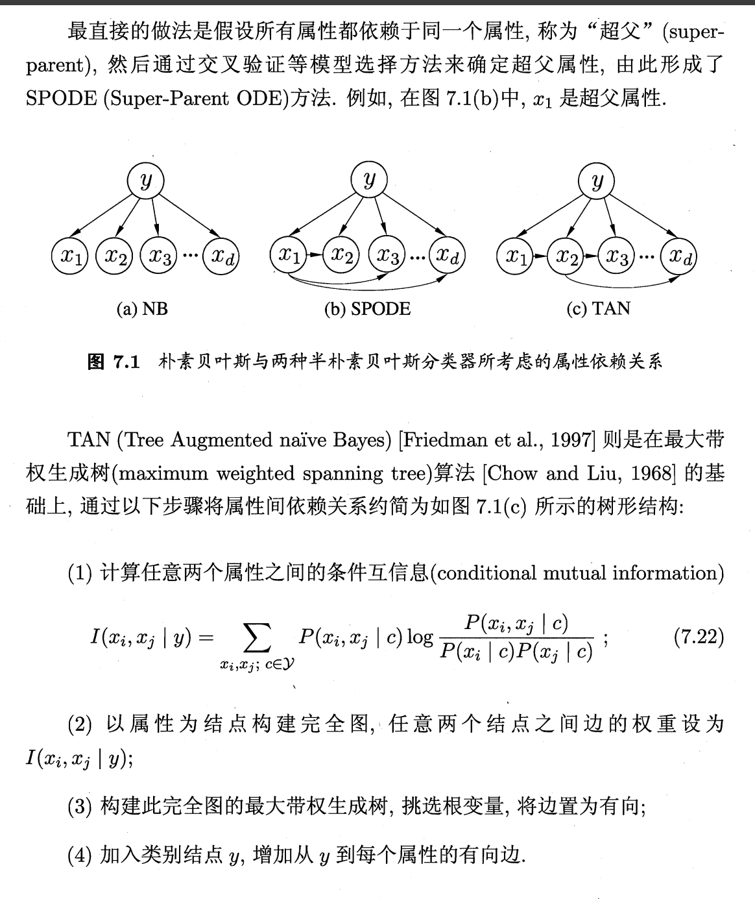

# Machine learning笔记\-7贝叶斯

贝叶斯模型属于：生成式模型generative

Then the expected loss of classifying sample 𝑥 as 𝑐𝑖 is

对于每一个样本 $x$，将其分类为 $c_i$ 所产生的期望损失（即条件风险）定义为

$R(c_i | x) = \sum_{j=1}^{N} \lambda_{ij} P(c_j | x)$

$\lambda_{ij}$**：损失函数（Loss / Penalty）**。这是一个关键的权重，代表将一个真实类别为 $c_j$ 的样本错误地分类为 $c_i$ 所带来的代价。

$P(c_j | x)$**：后验概率（Posterior Probability）**。即：在观测到样本 $x$ 的情况下，它真实类别为 $c_j$ 的概率。

**直观理解：** 风险 =$\sum$ \(判错的代价 $\times$ 判错的概率\)。

贝叶斯最优分类器 \(Bayes Optimal Classifier\)

To minimize the overall risk, we can simply select the class that minimizes the conditional risk 𝑅\(𝑐\|𝑥\) on each sample

我们的最终目标是寻找一个决策准则 $h: X \rightarrow Y$，使得在整个样本空间上的**总体风险 **$R(h)$ 达到最小。

- **逻辑推导：** 如果对于每一个具体的样本 $x$，我们都能找到一个类别，使得该样本的条件风险 $R(h(x)|x)$ 最小，那么累加起来的总体风险自然也是最小的。

- **贝叶斯决策准则：** 为了最小化总体风险，只需在每个样本上选择那个能使条件风险最小的类别。

$h^*(x) = \arg\min_{c \in \mathcal{Y}} R(c | x)$

$h^*(x) $Bayes optimal classifier 

$R(h^*)$ :Bayes risk 分类器能达到的最低风险。

$1-R(h^*)$:The best performance the classifier can achieve在当前特征空间下，模型性能的**极限**。换句话说，没有任何算法能超越这个准确率。

For each sample, select the class that maximizes the posterior probability

---

B\. 生成式模型 \(Generative Models\)

**曲线救国。** 它们试图理解数据生成的全过程。

- **策略：** 先建模联合概率分布 $P(x, c)$，或者根据**贝叶斯定理**拆解：

- $P(c|x) = \frac{P(x|c) P(c)}{P(x)}$

- **计算逻辑：**

    1. $P(c)$**（先验概率）：** 根据历史经验，这个类别出现的概率有多大？（容易获得）

    2. $P(x|c)$**（类条件概率/似然）：** 如果已知类别是 c，那么出现样本x的概率有多大？（这是建模的核心难点）

    3. $P(x)$**（证据）：** 用于归一化的常数。

- **典型代表：** **朴素贝叶斯 \(Naive Bayes\)**、高斯混合模型 \(GMM\)、隐马尔可夫模型 \(HMM\)。

Sufficient   i\.i\.d   全称：independent and identically distributed独立同分布

### 为什么估计 $P(c)$ 必须要求 i\.i\.d\.？

公式$P(c) = \frac{|D_c|}{|D|}$（用类别 $c$ 的样本数除以总样本数）在统计学上叫做**频率估计概率**。

之所以这个等式能成立，背后的核心支柱是**大数定律 \(Law of Large Numbers\)**。大数定律指出：

> 当试验次数（样本量）足够大时，**独立同分布**随机变量的算术平均值会趋近于它们的期望值。
> 
> 

- **如果没有独立性：** 样本之间有相关性。比如你收集了 10 个样本，但其实它们是同一个样本被复制了 10 遍。这时候计算出的 $\frac{|D_c|}{|D|}$ 显然是极度偏差的。

- **如果没有同分布：** 样本来源不一。比如你想预测全校学生的平均身高，但你采集的样本全是篮球队的，这属于采样偏差（Sampling Bias），估计出的 $P(c)$ 无法代表真实分布。

**潜在缺陷（零概率问题）：** 在学术严谨性上，若某个属性值在训练集中未出现（即 $|D_{c,x_i}| = 0$），会导致连乘项结果为 0，从而抹杀其他属性提供的所有信息。

对于连续型属性（如身高、温度、密度等），由于其取值空间是无限且连续的，无法直接通过频数计数。此时，我们需要引入**参数化密度估计（Parametric Density Estimation）**。

高斯分布=正态分布

我们通常假设在类别c 之下，第i个属性的取值服从**正态分布（Normal Distribution）**，即：

$p(x_i | c) \sim N(\mu_{c,i}, \sigma_{c,i}^2)$

其中，$\mu_{c,i}$ 和 $\sigma_{c,i}^2$ 分别是类别 $c$ 在该属性上的均值和方差。

**概率密度计算：** 将待预测样本的属性值 $x_i$代入高斯分布的概率密度公式：

$p(x_i | c) = \frac{1}{\sqrt{2\pi}\sigma_{c,i}} \exp\left(-\frac{(x_i - \mu_{c,i})^2}{2\sigma_{c,i}^2}\right)$

此处使用的是 $p$（小写），代表**概率密度**而非离散概率

拉普拉斯修正（Lapacian correction）

为了避免其他属性携带的信息被训练集中未出现的属性值“抹去”，在估计概率值时通常要进行“拉普拉斯修正”。

朴素贝叶斯分类器\(naÏve Bayes classifier\) 采用了 "属性条件独立性假设" \(attribute conditional inpendence assumption\): 假设所有属性相互独立\.

若任务对预测速度要求较高，则对给定训练集，可将朴素贝叶斯分类器涉及的所有概率估值事 先计算好存储起来，这样在进行预测时只需"查表"即可进行判别;

垃圾邮件分类；

文本分类；

实时推荐；

简单风险识别；  

大规模快速分类任务。

若任务数 据更替频繁，则可采用"懒惰学习" \(lazy learning\) 方式，先不进行任何训练， 待收到预测请求时再根据当前数据集进行概率估值;若数据不断增加，则可在 现有估值基础上，仅对新增样本的属性值所涉及的概率估值进行计数修正即可 实现增量学习\. 

朴素贝叶斯适合使用在：

- 需要高预测速度； 

- 数据量较大； 

- 文本分类、垃圾邮件分类等高维稀疏任务； 

- 数据频繁更新； 

- 需要增量学习； 

- 特征之间近似独立，或者即使不完全独立也能接受近似结果的任务。

朴素贝叶斯存在的问题：条件独立假设太强

• In most cases, the assumption of conditional independence given the class label is violated\. 

• For example, much more likely to find the word Barack if we saw the word Obama regardless of the class 

• There are models that can improve upon this assumption without using the full conditional model 

• Semi\-naïve Bayes Classifiers: appropriately considers the interdependence information among some attributes\. • Bayesian Network   

Semi\-naïve Bayes 可以翻译为：

> **半朴素贝叶斯分类器**
> 
> 

它的核心思想是：

> 不再假设所有属性在类别条件下完全独立，而是允许部分属性之间存在依赖关系。
> 
> 

因此，通过最大生成树算法， TAN 实际上仅保留了强相关属性之间 的依赖性

